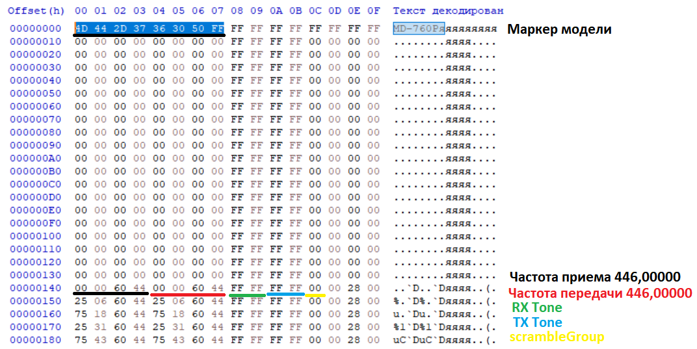

# Data file`. t`Detailed format specification

The full format description below`.td`TIDRadio**TD-CPS Programming Software**using disassembled code. The document describes all offsets, data types, sizes, and coding formats.

> [APRS description](aprs.md), [GNSS description](gnss.md)

---

## 1. The nature of the file

`.td` — **raw dump EEPROM-image radio**size**65,536 bytes (0x10000)**No compression or encryption.

* Size source:`Settings.EEROM_SPACE = 65536u` (`Settings.cs:2053`).
* Empty/unused byte =`0xFF`.
* Reading/write--`File.ReadAllBytes` / `File.WriteAllBytes` (`MainForm.cs:1930,1979,1995`).
* Formed`MainForm.DataToByte()` (`MainForm.cs:2388`):`0xFF`, then weaves the blocks in order:`Channels → GeneralSet → A/B → FM → DTMF → GNSS/APRS`.
* Image analysis.`MainForm.ByteToData()` (`MainForm.cs:2410`), reads the same blocks.

### Which blocks are woven (`DataToByte`, `MainForm.cs:2388-2408`)

| Order. | The challenge | Block. |
| --- | --- | --- |
| 1 | `ChannelForm.data.ToEerom(0)` → `CPS_CHANNEL_START` | Channels + names + indexes |
| 2 | `GeneralSetForm.ToEerom(array)` | General settings |
| 3 | `A_B_ChannelForm.ToEerom(array)` | VFO A/B + shift |
| 4 | `FMForm.ToEerom(array)` | FM channels/settings |
| 5 | `DTMFCodeForm.ToEerom(array)` | DTMF codes |
| 6 | `Array.Copy(GnssAprsRawData, ..., 12292, ...)` | GNSS/APRS (if any) |

---

## 2. File header - marker`. t`(bytes 0-7)

It is important not to mix two things:**filemarker`.td`** и **device ID**. These are different 8-byte values stored in different locations.

### 2.1 Marker`. t`- one for all models

When saved in bytes 0-7 file is written**global** `Settings.CUR_MODEL` (`Settings.cs:146,2057`:

```
0x4D 0x44 0x2D 0x37 0x36 0x30 0x50 0xFF
 'M'  'D'  '-'  '7'  '6'  '0'  'P'
```

= ASCII**`"MD-760P"` + `0xFF`**.

* This marker.**equally**for all models (H3/H4/H7/H8/H9/638) and all modes. The program does not distinguish which model saved the file.
* At the opening,`openCodeplugFile`, `MainForm.cs:1996-2009`only one of the two shall be checked:
* first 8 bytes**everything`0xFF`**The file is considered empty / default - opens;
* first 8 bytes**equal`CUR_MODEL`** (`"MD-760P\xFF"`) is opened;
* “Model does not match,” he said.
* Comparison of the file with the selected model in this place**no**- only the marker is checked.

### Device firmware identifier - NOT in`. t`

For reference: per-model 8-byte identifiers from`OpenGD77Form.GetSupportedVersions()` (`OpenGD77Form.cs:615-637`is`VersionIdentifier` **radio**It is readable from hardware via USB rather than the file header. In`.td`They don't figure:

| Model | DisplayName | Regime. | VersionIdentifier (hex) | ASCII |
| --- | --- | --- | --- | --- |
| H3Plus | H3 Plus | Normal. | `503331313833FFFF` | `P31183`+FF FF FF |
| H3Plus | H3 Plus | GMRS | `503331313834FFFF` | `P31184`+FF FF FF |
| H3Plus | H3 Plus | Ham Ham Ham | `503331313835FFFF` | `P31185`+FF FF FF |
| H4 | H4 | Normal. | `54444834FFFFFF4E` | `TDH4`+FF FF FF`N` |
| H4 | H4 | GMRS | `54444834FFFFFF47` | `TDH4`+FF FF FF`G` |
| H4 | H4 | Ham Ham Ham | `54444834FFFFFF48` | `TDH4`+FF FF FF`H` |
| H7Plus | H7 Plus | Normal. | `54444837504C554E` | `TDH7PLUN` |
| H7Plus | H7 Plus | GMRS | `54444837504C5547` | `TDH7PLUG` |
| H7Plus | H7 Plus | Ham Ham Ham | `54444837504C5548` | `TDH7PLUH` |
| H8-4r d d | H8-4r d d | Normal. | `544448383447454E` | `TDH84GEN` |
| H8-4r d d | H8-4r d d | GMRS | `5444483834474547` | `TDH84GEG` |
| H8-4r d d | H8-4r d d | Ham Ham Ham | `5444483834474548` | `TDH84GEH` |
| H9 | H9 | Normal. | `54444839FFFFFF4E` | `TDH9`+FF FF FF`N` |
| H9 | H9 | GMRS | `54444839FFFFFF47` | `TDH9`+FF FF FF`G` |
| H9 | H9 | Ham Ham Ham | `54444839FFFFFF48` | `TDH9`+FF FF FF`H` |
| 638UV | 638UV | Normal. | `544436333855564E` | `TD638UVN` |
| 638UV | 638UV | GMRS | `5444363338555647` | `TD638UVG` |
| 638UV | 638UV | Ham Ham Ham | `5444363338555648` | `TD638UVH` |

### Model capabilities`Settings.cs:570-651`)

| Series | GNSS | GNSS-Station Type | APRS | MidPower | TopKey | KeyCode2=GNSS | Thai | PY32 | BLE-ONLY |
| --- | --- | --- | --- | --- | --- | --- | --- | --- | --- |
| H3Plus | – | – | – | – | – | – | – | – | – |
| H4 | + | + | + | – | + | + | + | + | – |
| H7Plus | + | – | – | + | – | – | – | – | – |
| H8 | – | – | – | + | + | – | – | – | + |
| H9 | + | + | + | + | + | + | + | + | – |
| 638UV | + | + | + | + | + | + | + | + | – |

---

## General offset map of 64 KB

Source:`DMR/CpsAddrCfg.cs`.

| Displacement. | hex | Contents | Size |
| --- | --- | --- | --- |
| 0 | 0x0000. | marker`"MD-760P\xFF"` | 8 |
| 16 | 0x0010 | channel data`CPS_CHANNEL_START`) | 3184 (199x16) |
| 3216 | 0x0C90 | General settings (keyConfig...bandConfig)`ADDR_GENERAL_SET`) | 3272 |
| 3234 | 0x0CA2 | FM: workMode+monitor (bit 7 and bit 3) | 1 |
| 3238 | 0x0CA6 | FM: currentChannel | 1 |
| 3248 | 0x0CB0 | Frequency shift VFO A/B`CPS_FREQ_OFFSET_START`) | 8 (4+4) |
| 3264 | 0x0CC0 | bandConfig (frequency bands) | 8 |
| 3280 | 0x0CD0 | FM channels (25×4) | 100 |
| 3392 | 0x0D40 | channel names | 1592 (199x8) |
| 6144 | 0 x1800 | DTMF: stun/kill/localId/.../end (see §7) | 224 |
| 6400 | 0x1900 | channel index (validity) | 25 |
| 6432 | 0 x1920 | scanner | 25 |
| 6464 | 0x1940 | FM: Valid channel bitmap | 4 |
| 6480 | 0x1950 | VFO A | 16 |
| 6496 | 0x1960 | VFO B | 16 |
| 6512 | 0x1970 | FM VFO frequency | 4 |
| 6516 | 0x1974 | `CPS_FM_SETTINGS`- just declared,**unused** | 2 |
| 7168 | 0x1C00 | bootMsg1 | 16 |
| 7184 | 0 x1C10 | bootMsg2 | 16 |
| 7200 | 0x1C20 | bootMsg3 | 16 |
| 7968 | 0x1F20 | micGain | 1 |
| 7976 | 0x1F28 | languageSelect | 1 |
| 7977 | 0x1F29 | displayStyle | 1 |
| 7978 | 0x1F2A | menuColor | 1 |
| 7979 | 0x1F2B | vfoScanUpperLimit | 2 |
| 7981 | 0x1F2D | vfoScanLowerLimit | 2 |
| 7983 | 0x1F2F | scanHangTime | 1 |
| 12292 | 0x3004 | Extended functions/region (ext func) | 58 |
| 12390 | 0x3066 | [**GNSS configuration**](gnss.md) | 21 |
| 12390 | 0x3066 | GPS On/Off (0 - Off, 1 - On) | 1 |
| 12391 | 0x3067 | GPS Position Type (0 - Deg, 1 - Deg.min, 2 - Deg.min.sec) | 1 |
| 12392 | 0x3068 | GPS Time Zone (0(UTC-12)..24(UTC+12) | 1 |
| 12393 | 0x3069 | Speed Unit (0 - Km/h, 1 - Knot, 2 - m/s) | 1 |
| 12394 | 0x306A | Dist Unit (0 - Km/h, 1 - Sea mile, 2 - Mile) | 1 |
| 12395 | 0x306B | Alt Unit (0 - Meters, 1 - Ft) | 1 |
| 12396 | 0x306C | Fixed Longitude (BigEndian UInt32, degrees\*1e-6) | 4 |
| 12400 | 0x3070 | Fixed Longitude E/W (ASCII) | 1 |
| 12401 | 0 x3071 | Fixed Latitude (BigEndian UInt32, degrees\*1e-6) | 4 |
| 12405 | 0x3075 | Fixed Latitude N/S (ASCII) | 1 |
| 12406 | 0x3076 | Fixed Altitude (BigEndian Int32, value\*1e-6) | 4 |
| 12410 | 0x307A | *RESERVED* | 1 |
| 12411 | 0x307B | GNSS-station type (0 - Fix, 1 - GPS) | 1 |
| 12412 | 0x307C | [**APRS configuration**](aprs.md) | 152 |
| 12412 | 0x307C | APRS Switch (0 - Off, 1 - On) | 1 |
| 12413 | 0x307D | Callsign (call sign) without SSID | 6 |
| 12419 | 0x3083 | Callsign[SSID](http://aprs.ru/index.php/SSID)(0-15) | 1 |
| 12420 | 0x3084 | Icon Table Primary / Secondary Symbol`/` `\`(character table) | 1 |
| 12421 | 0x3085 | *RESERVED* | 16 |
| 12437 | 0x3095 | Commentary on the Beacon package, up to 40 characters | 40 |
| 12477 | 0x30BD | *RESERVED* | 25 |
| 12502 | 0x30D6 | Icon Main Symbol according to[table](APRS_symbols.md), numbering from zero | 1 |
| 12503 | 0x30D7 | MIC-E Start (0 - Off, 1 - On) | 1 |
| 12504 | 0x30D8 | MIC-E Type (0..7) | 1 |
| 12505 | 0x30D9 | Route-1: Name (WIDE1) | 8 |
| 12513 | 0x30E1 | Route-1 Count | 1 |
| 12514 | 0x30E2 | Route 2: Name (WIDE2) | 8 |
| 12522 | 0x30EA | Route-2 Count | 1 |
| 12523 | 0x30EB | Report Voltage (0 - Off, 1 - On) | 1 |
| 12524 | 0x30EC | Report Sats (0 - Off, 1 - On) | 1 |
| 12525 | 0x30ED | Report Mileage (0 - Off, 1 - On) | 1 |
| 12526 | 0x30EE | PTT Linkage (0 - Off, 1 - On) | 1 |
| 12527 | 0x30EF | Timed Beacon (0 - Off, 1 - On) | 1 |
| 12528 | 0x30F0 | Time Interval (Uint16 Little-Endian) | 2 |
| 12530 | 0x30F2 | APRS-Relay DIGI Forward Channel (0 - Channel A, 1 - Channel B, 2 - A+B) | 1 |
| 12531 | 0x30F3 | APRS-Relay DIGI1 Enabled (0 - Off, 1 - On) | 1 |
| 12532 | 0x30F4 | APRS-Relay DIGI1 Name (WIDE1) | 8 |
| 12540 | 0x30FC | APRS-Relay DIGI2 Enable (0 - Off, 1 - On) | 1 |
| 12541 | 0x30FD | APRS-Relay DIGI2 Name (WIDE2) | 8 |
| 12549 | 0x3105 | Wait Before Forward (0.9) | 1 |
| 12550 | 0x3106 | APRS-Relay Remote Password (ASCII Digits 0-9) | 8 |
| 12558 | 0x310E | APRS RX Channel (0 - Off, 1 - A, 2 - B) | 1 |
| 12559 | 0x310F | APRS TX Channel (0 - A-Lock, 1 - B-Lock, 2 - A-Auto, 3 - B-Auto, 4 - A+B) | 1 |
| 12560 | 0x3110 | APRS PTT Priority (0 - Call, 1 - APRS) | 1 |
| 12561 | 0 x3111 | *RESERVED* | 2 |
| 12563 | 0 x3113 | APRS RX Auto Popup (0 - Off, 1 - On) | 1 |
| 12564 | 0x3114 | `CPS_FULL_BUFFER_SIZE`The End of Real Data |  |
| 32768 | 0x8000 | expanded channels (`CPS_EXT_CHANNEL_START…0xCB8D`) |  |

Substantive work area:`CPS_START=16`, `CPS_END=7984`, `CPS_LEN=8000`.

---

## 4. Common coding formats (used again)



### 4.1 Frequency - packed BCD, 8 digits, little-endian pairs

4 bytes, 2 numbers per byte. Meaning in**Hz**as an 8-digit whole (`000.00000`MHz.

* Example:`446.03125`MHz.`44603125`Hz.`{0x25, 0x31, 0x60, 0x44}`.
* byte`[0]`= the smallest pair of digits (last 2 digits Hz),`[3]`= senior.
* Empty/reset: all bytes`0xFF`(channels, VFO) or`0`(FM).
* Reads by gluing`[3][2][1][0]`The point after the 3rd digit`0.00000`.
* Functions:`ChannelForm.CaculateFreq_*`, `A_B_ChannelForm.EncodeFrequency`.

### 4.2 CTCSS/DCS subton - 2 bytes

* **CTCSS**4 BCD code digits in decihertz (e.g.`88.5` → `885` → `"0885"`).`byte[0]`= last 2 digits`0x85`)`byte[1]`= first 2`0x08`). OFF!`{FF FF}`.
* **DCS**: `byte[0]` = `(десятки<<4)|единицы`three-digit octal code;`byte[1]` = `(полярность<<4)|сотни`polarity`8`=N`0xC`=I. Line.`D023N`/`D023I`.
* Type definition: senior tetrad`byte[1]` `<8`CTCSS,`>=8`DCS.
* Functions:`ChannelForm.CaculateSubaudio_*`, `A_B_ChannelForm.EncodeSubaudio`.

### 4.3 Serialization of structures

* `Settings.objectToByteArray(obj, chunkSize)` (`Settings.cs:1647`:`Marshal.StructureToPtr`Byte copying.
* `Settings.smethod_62(byte[], Type)` (`Settings.cs:1673`:`Marshal.PtrToStructure`(bytes → structure)
* Line names: encoding**GB2312** (`Settings.smethod_23/smethod_25`).

---

## Channel block (16/0x10 displacement)

### 5.1 Channel data`Channel One`- 16 bytes x 199

Source:`DMR/ChannelForm.cs:197-220`.

| +off | Field. | Type | Size |
| --- | --- | --- | --- |
| +0 | `rxFreq` | byte[4] (BCD, § 4.1) | 4 |
| +4 | `txFreq` | byte[4] (BCD) | 4 |
| +8 | `rxTone` | byte[2] (subton, § 4.2) | 2 |
| +10 | `txTone` | byte[2] | 2 |
| +12 | `scrambleGroup` | byte (0-16) | 1 |
| +13 | `flags1` | byte (see below) | 1 |
| +14 | `flags2` | byte | 1 |
| +15 | `reserved` | byte | 1 |

**`flags1`**(conservation mask)`&0xE4`): bits 7-6`PttId`(0..3), bit 5`FreqHop`bit 2`BusyLock`.
**`flags2`**mask`&0x3B`): bits 5-4`PowerLevel`(0=L,1=M,2=H), bit 3`ChBand`(0=Wide,1=Narrow), bits 1–0`FreqOffset`(0=off,1=-,2=+).**`reserved`**: bits 1-0 =`RxModel`(0=FM, 1=AM).

Names are not included in this block (see § 5.2).

### 5.2 Names of channels`ChannelNameOne`8 bytes × 199 (shift 3392 / 0x0D40)

`channelName: byte[8]`— GB2312, the remainder after the text`0xFF`.

### 5.3 Channel index (shift 6400 / 0x1900) – 25 bytes

Bit card "Channel Validen", 199 channels (bits 0.198).`chIndex`the channel is valid if the RX frequency is vaporized and`> 0`. Work through`BitArray`.

### 5.4 Scan index (shift 6432 / 0x1920) - 25 bytes

Bit card "channel in the scan list", the same 199 bits.

### How the block is constructed (see para.`ChannelForm.ToEerom(0)`60,000

| Section | Inward displacement. | Abs. EEPROM. | Size |
| --- | --- | --- | --- |
| channel | 0 | 16 | 199×16=3184 |
| names | 3376 | 3392 | 199×8=1592 |
| chIndex | 6384 | 6400 | 25 |
| scanIndex | 6416 | 6432 | 25 |

---

## General settings block`GeneralSet`(address 3216 / 0x0C90)

Source:`DMR/GeneralSetForm.cs:69-158`, `Settings.ADDR_GENERAL_SET=3216`, `Settings.SPACE_GENERAL_SET=Marshal.SizeOf(GeneralSet)=93`(Logical; actually the fields are scattered).

| Abs. bias. | +off from 3216 | Field. | Type/size | Coding |
| --- | --- | --- | --- | --- |
| 3216 | +0 | `keyConfig[0]` | byte | TopKeyShort (0 if no TopKey) |
| 3217 | +1 | `keyConfig[1]` | byte | Side1KeyShort |
| 3218 | +2 | `keyConfig[2]` | byte | Side2KeyShort |
| 3219 | +3 | `keyConfig[3]` | byte | TopKeyLongong |
| 3220 | +4 | `keyConfig[4]` | byte | Side1KeyLong |
| 3221 | +5 | `keyConfig[5]` | byte | Side2KeyLong |
| 3224 | +8 | `aniEnable` | byte | on/off DTMF alarms |
| 3225 | +9 | `dtmfResetTime` | byte | /5S/10S/15S |
| 3226 | +10 | `autoAnswer` | byte | machine |
| 3227 | +11 | `dtmfSpeed` | byte | speed of DTMF 80.150ms |
| 3228 | +12 | `scanRange` | byte | scanner |
| 3229 | +13 | `backlightLevel` | byte | 0. 4. |
| 3232 | +16 | `optionConfig[16]` | byte[16] | bit settings, see the table below |
| 3264 | +48 | `bandConfig[8]` | byte[8] | frequency bands, see below |
| 7168 | [+3952] | `bootMsg1[16]` | byte[16] | loading message 1 |
| 7184 | [+3968] | `bootMsg2[16]` | byte[16] | 2 |
| 7200 | [+3984] | `bootMsg3[16]` | byte[16] | 3 |
| 7968 | [+4752] | `micGain` | byte | 0.32. |
| 7976 | [+4760] | `languageSelect` | byte | language |
| 7977 | [+4761] | `displayStyle` | byte | display |
| 7978 | [+4762] | `menuColor` | byte | menu |
| 7979 | [+4763] | `vfoScanUpperLimit[2]` | byte[2] | 16-bit LE (1.999) |
| 7981 | [+4765] | `vfoScanLowerLimit[2]` | byte[2] | 16-bit LE |
| 7983 | [+4767] | `scanHangTime` | byte | delay |

### `optionConfig[16]`- bitwise decoding (shift 3232)

| byte | Bits | Appointment |
| --- | --- | --- |
| `[0]` | 7 TxScreenOn, 6 RxScreenOn, 4=Ham mode, 3=GMRS mode, 2 DtmfSidetone, 1 PriorityTxBusy | screens/mode/DTMF |
| `[1]` | bit 6-5? (GetBits shift6 mask3) ScanMode, bit 4 KeyAutoLock, bit 2 KeyBeep, bit 0 VoiceAnnounce | scan/sound |
| `[2]` | 7 RadioVfoMode, bit 4 (mask3) ToneFreq, bit 3 RadioMonitor, bit 2 ADisplayOn, bits 0-1 AChannelMode | regimes A |
| `[3]` | bit 6 (mask3) BootDisplay, bit 4 BDisplayOn, bit 2 DualWatch, bits 0-1 BChannelMode | regimes B |
| `[4]` | 8 | `AChannelNum`(channel number A) |
| `[5]` | 8 | `BChannelNum` |
| `[6]` | — | unused |
| `[7]` | 6 TailEliminate, 0-2 VoxLevel bits, and 4 RemouteKill, 3 RemoteStun bits (for DTMF options) | tail |
| `[8]` | Senior Notebook AStep, Junior BStep | grid-step |
| `[9]` | 8 | noise reduction level (0.9) |
| `[10]` | 8 | TOT (index) |
| `[11]` | bits 6-5 TxEndTone, bits 4/3/2 Tx200En/Tx350En/Tx500En | pitches |
| `[12]` | 8 | PowerSave (index) |
| `[13]` | 8 | AutoBacklight (index) |
| `[14]` | bits 0-3 VoxDelay | delay VOX |
| `[15]` | 7 SingleChannelMode, 0-1 AlarmMode bits, 4-6 BreathLed bits | supplementary regimes |

> Note: accurate masks`BitHelper.SetBits (маска 3/7/15)`. Some flags are coded through`IsHamMode/IsGMRSMode`automatically.

### `bandConfig[8]`(shift 3264)

Two "bottom-up" ranges of 2 values, each BCD 3 digits of 2 bytes (`EncodeFreqToBCD`:
-`[0..1]`= lower bound of range 1 (MHz)
-`[2..3]`= upper limit of range 1
-`[4..5]`= lower bound of range 2
-`[6..7]`= upper limit of range 2

Value format:`bytes[off]=(сотни<<4)|десятки`, `bytes[off+1]=(единицы<<4)|0`. default`"108-174"` / `"200-600"`.

### bootMsg (7168/7184/7200)

Up to 16 printed ASCII (from`' '`before`'~'`), GB2312, zero residue.

---

## 7. DTMF block (shift 6144/0x1800)

Source:`DMR/DTMFCodeForm.cs:18-136`. Each byte = one DTMF number (0–9,A,B,C,D,\*,#) with values of 0–15.

| Displacement. | Field. | Length | Range. |
| --- | --- | --- | --- |
| 6144 | `stunCode` | 16 | 6144-6159 |
| 6160 | `killCode` | 16 | 6160-6175 |
| 6176 | `localId` | 3 | 6176-6178 |
| 6185 | `groupCode` | 1 | 6185 |
| 6192 | `codeGroup1` | 16 | 6192-6207 |
| 6208 | `codeGroup2` | 16 | 6208-6223 |
| 6224 | `codeGroup3` | 16 | 6224-6239 |
| 6240 | `codeGroup4` | 16 | 6240-6255 |
| 6256 | `codeGroup5` | 16 | 6256-6271 |
| 6272 | `codeGroup6` | 16 | 6272-6287 |
| 6288 | `codeGroup7` | 16 | 6288-6303 |
| 6304 | `codeGroup8` | 16 | 6304- 6319 |
| 6336 | `startCode` | 16 | 6336-6351 |
| 6352 | `endCode` | 16 | 6352-6367 |

* **STUN/KILL/START/END**byte`[15]`= line length; number codes c`[0]`.
* **localId/codeGroup1.. 8.**: simple array of numbers with`[0]`leftover`0xFF`.
* Unused holes: 6179–6184, 6186–6191, 6320–6335.
* `optionConfig[7]`GeneralSet carries flags`RemoteStun`(bit 3 = 0x08) and`RemoteKill`(bit 4 = 0x10).

---

## Block VFO A/B (shifts 6480 and 6496)

Source:`DMR/A_B_ChannelForm.cs:71-122`. Structure`VfoData`16 bytes.

| +off | Field. | Type/size | Comments |
| --- | --- | --- | --- |
| +0 | `rxFreq` | byte[4] | BCD § 4. 1st |
| +4 | `txFreq` | byte[4] | BCD § 4. 1st |
| +8 | `rxCtcDcs` | byte[2] | subaudio § 4. 2. |
| +10 | `txCtcDcs` | byte[2] | subaudio § 4. 2. |
| +12 | `scrambler` | byte |  |
| +13 | `byte13` | byte | bits 7-6 PttId, bit 5 HopFreq, bit 2 BusyLock |
| +14 | `byte14` | byte | bit 6 ScramblerEn, bits 5–4 Power, bit 3 NarrowBand, bits 1–0 OffsetDir |
| +15 | `byte15` | byte | bits 1-0 RxModel |

Default: frequencies`{FF×4}`tones`{FF FF}`, `byte14=0x20`, the rest 0.

### Frequency shift (shift 3248 / 0x0CB0)

* `[0..3]`= shift VFO A,`[4..7]`= shift VFO B.
* BCD 6-digit number (position)`0.00000`), little-endian in pairs, 4 bytes.
* Empty/reset = 4 zero bytes.

---

## 9. FM block (shifts 3234, 3238, 3280, 6464, 6512)

Source:`DMR/FMForm.cs:526-595`.

| Displacement. | Contents | Size | Note |
| --- | --- | --- | --- |
| 3234 | workMode + monitorEnable packaged: bit 7 = workMode (0=VFO,1=ыמ), bit 3 = monitorEnable | 1 |  |
| 3238 | currentChannel (1.25) | 1 |  |
| 3280 | `radioChannels[100]`- 25 channels × 4 bytes | 100 | frequency, BCD, significant 2 bytes |
| 6464 | `validChannels[4]`A bitmap of 25 channels | 4 | bit`n`(1.25) → byte`(n-1)/8`bit`(n-1)%8` |
| 6512 | `vfoFreq[4]`- FM VFO frequency | 4 | BCD, significant 2 bytes |
| 6516 | `CPS_FM_SETTINGS`(declared) | 2 | **not used by FMForm** |

**Frequency of the FM channel (4 bytes, significant 2):**
- `num = round(freq_MHz × 10)`(0.1 MHz step, range 76-108).
-`buffer[0]` = `(десятки<<4)|единицы`, `buffer[1]` = `(сотни<<4)|тысячи` (`EncodeFrequency`).
- Example:`107.5` → `1075` → `buffer[0]=0x75, buffer[1]=0x10, buffer[2]=0, buffer[3]=0`.
- Decoding:`(b1>>4)*1000 + (b1&F)*100 + (b0>>4)*10 + (b0&F)`Divided by 10. Out 76-108 → 76.0.

---

## 10. GNSS/APRS region (shifts 12292/0x3004 and beyond)

### 10.1 Nature of the block: “pass-through”

Key feature:**This CPS DOES NOT decrypt or edit GNSS/APRS fields individually.**Disassembled code has no structure or form to build it. The Domain`12292..12564`It is copied as an opaque byte buffer:

* `GnssAprsRawData` (`MainForm.cs:25`) - raw`byte[]`.
* **Record:** `ByteToData`When reading the image from the file / radio:`csharp
  if (Settings.HasGNSS() && eerom.Length >= 12411) {
  int num = 12292;
  int num2 = (Settings.HasAPRS() ? 12564 : 12411);
  GnssAprsRawData = new byte[num2 - num];
  Array.Copy(eerom, num, GnssAprsRawData, 0, num2 - num);
  }`
  (`MainForm.cs:2471-2484`)
* **Reading:** `DataToByte`while preserving the image:`csharp
  if (Settings.HasGNSS() && GnssAprsRawData != null) {
  Array.Copy(GnssAprsRawData, 0, array, 12292, GnssAprsRawData.Length);
  }`
  (`MainForm.cs:2399-2406`)
* Removal/discharge`GnssAprsRawData = null` (`MainForm.cs:2869`).
* When working with the radio, the entire region is read / written separately n`ReadDataNewProtocol`/`WriteDataNewProtocol`(range to 12564 or 12411), the default value is`0xFF` (`OpenGD77Form.cs:1932-1957, 2008-2020`).

**Inquest:**internal byte layout of GNSS/APRS settings in`MainForm.cs`Undefined – these bytes are taken “as is” from the device (the format is inherited from the OpenGD77/GD77 codebug) and stored in the`.td`unchanged.

### Known map of the region (from`DMR/CpsAddrCfg.cs:181-211`)

| Displacement. | hex | Field. | Length | Observation |
| --- | --- | --- | --- | --- |
| 12292 | 0x3004 | `CPS_EXT_FUNC` / `CPS_EXT_REGION_START` | 58 | Extended functions/beginnings of “extended region” |
| 12390 | 0x3066 | `CPS_GNSS_CONFIG_START` | 21 | GNSS configuration |
| 12411 | 0x307B | `CPS_GNSS_STATION_TYPE_START` | 1 | type |
| 12412 | 0x307C | `CPS_APRS_CONFIG_START` | 152 | APRS configuration |
| 12564 | 0x3114 | `CPS_APRS_CONFIG_END` = `CPS_EXT_REGION_END` | — | end of real data`CPS_FULL_BUFFER_SIZE`) |

Also aliased:`CPS_GNSS_REGION_START = 12390`, `CPS_GNSS_REGION_END = 12564`(from GNSS to APRS, 174 bytes)

### Dynamic region length (model)

The actual size of the copyable block depends on the capabilities of the selected model.`Settings.HasGNSS()` / `HasAPRS()` / `HasGNSSStationType()`:

| Conditions | Beginning | End (= end of block) | Size |
| --- | --- | --- | --- |
| `HasGNSS()` + `HasAPRS()` | 12292 | **12564** | 272 |
| `HasGNSS()`without APRS | 12292 | **12411** | 119 |
| `HasGNSS()` + `HasGNSSStationType()`(H4/H9/638) | 12292 | 12411 (stop at 12411) | 119 |
| `HasGNSS()`station-type free (H7Plus) | 12292 | 12411 | 119 |
| no`HasGNSS()`(H3, H8) | — | — | block**spellless** в `.td`stays`0xFF` |

* `HasGNSS()`= H4, H7Plus, H9, 638UV (all modes). H3, H8, no.
* `HasAPRS()`= H4, H9, 638UV.
* `HasGNSSStationType()`H4, H9, 638UV (H7Plus APRS/station-type does not, so the tail is cut at 12411)

Formula in code (`MainForm.cs:2476`, `OpenGD77Form.cs:1935,2011`:

```
num2 = HasGNSS() ? (HasAPRS()   ? 12564     // APRS-модели
                   : 12411)      // GNSS-без-APRS
       : —                       // блока нет
При отсутствии HasGNSSStationType() -> num2 принудительно = 12411
```

### 10.4 Where GNSS/APRS settings could live

* In the interface, the mention of GNSS is limited to the keymark`KeyCode2IsGNSS()`= GNSS menu for H4/H9/638`GeneralSetForm.cs:1762-1764`). The very form of editing GNSS/APRS fields in this build is absent.
* GNSS/APRS settings**non-serialize**any of the structures (§§ 5-9). In`.td`They are present only as a copy of the data read from the radio.

> **Comment on completeness of documentation:**Since the internal fields of GNSS (12390, 21 bytes) and APRS (12412, 152 bytes) are not understood anywhere in the disassembled code, their exact byte semantics (for example, callsign / beacon / sending intervals fields) for this project cannot be restored - the code stores their byte-in-bytes. To describe these fields by name, you need OpenGD77 anchors (the GD77 firmware source), not this CPS.

---

## 11. Related constants of models`Settings.cs`)

* `SUPER_PWD = "DT8168"`(140).
* `CUR_MODE = 2`(2097)`CUR_CH_GROUP = 0`, `CUR_ZONE_GROUP = 0`, `CUR_ZONE = 0`.
* Frequency boundaries (Normal/Ham): RX 108–174 and 200–600 MHz; Ham TX 144–148 and 420–450 MHz; H4 – 6 bands`H4_MIN/MAX_FREQ`.
* `MIN_FREQ={200,108}`, `MAX_FREQ={600,174}`, `MIN_FREQ_FM={76}`, `MAX_FREQ_FM={108}`, `FREQ_STEP_1=250`, `FREQ_STEP_2=625`.
* `GMRS_STANDARD_FREQS`30 value 462.5625-467.7250 MHz.

---

## 12. Important observations

1. **Field.`name`(string) channel is not included in 16 bytes**Names are placed in a separate name block.
2. **`ToEerom`Ignoring channels`chGroupIndex`**- puts one group from the beginning; grouping - at the level`MainForm`along`CPS_*`addresses.
3. **Code discrepancies:** `CPS_FM_SETTINGS_START=6516`claimed, but actually used 3234/3238.`.g77`/`.dat`open with the same code as the`.td`(raw EEPROM)
4. `.td`Retains a size of 65,536 bytes; when reading a short buffer`ByteToData`Copy only available boundaries (protection by length).

---

## 13. Examples of decoding

1. [**td->csv**](td_to_csv.py)Extract channels from .td file to CSV (Python)

---

## 14. Example of coding

1. [**csv->td**](csv_to_td.py)Change the channels in the .td file from CSV (Python)

## 15. Example of implementation

1. [**TDRadioCodeplug**](TDRadioCodeplug.cs)Class for working with .td file.
2. [**TidRadioTool**](TDRadioTool/bin)- console utility
3. [**TD Editor**](td-editor.html)- HTML channel editor[online](https://dkxce.github.io/temporary/td-h9/td-editor.html)
4. [**TD-APRS-Editor**](td-editor-aprs.html)- aprs-html channel editor[online](https://dkxce.github.io/temporary/td-h9/td-editor-aprs.html)