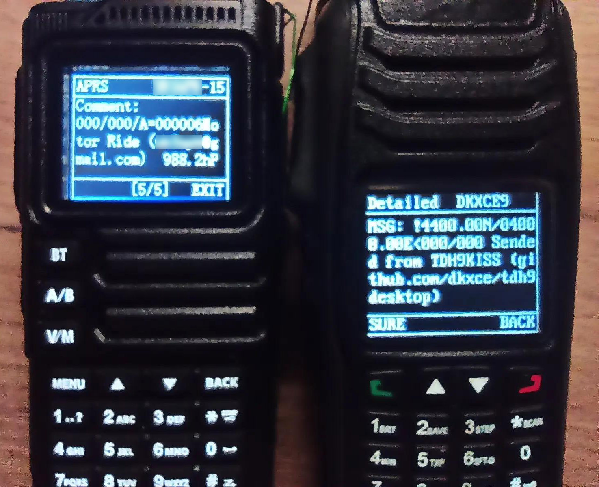

# Tidradio TD-H9 Documentation, Specification, Manual, Disasm, APRS

## Resources (Основные ресурсы)
|...|...|
|---|---|
| **Repositiry** (Репозиторий) | [dkxce/Tidradio-TD-H9](https://github.com/dkxce/Tidradio-TD-H9) |
| **Media** (Изображения) | [Tidradio TD-H9 Images](radio_images.md) |

### Manuals (Инструкции)
| Manual (Инструкция) | Localization (Язык) | Format (Формат) | Link (Ссылка) | Description (Описание) |
|---|---|---|---|---|
| Original | EN | PDF | [Original Manuals](Original%20Manuals) | *origin vendor manual* |
| TD-H9 Users Manual | EN | .md | [TD-H9_manual.en.md](TD-H9_manual.en.md) | *auto translate* |
| TD-H9 Users Manual | EN | .docx | [TD-H9_manual.en.docx](TD-H9_manual.en.docx) | *auto translate & convert* |
| TD-H9 Руководство пользователя (инструкция) | RU | .md | **[TD-H9_manual.ru.md](TD-H9_manual.ru.md)** | **source** (*based on firmware **1.0.33***) |
| TD-H9 Руководство пользователя (инструкция) | RU | .docx | [TD-H9_manual.ru.docx](TD-H9_manual.ru.docx) | *auto convert* |
| Описание формата .td | RU | .md | [Disasm](Customer%20Programming%20Software/Disasm)  | *source* |

## Channel Software (Настройка каналов)
|...|...|...|
|---|---|---|
| **CPS** (PC Channels Software) | [CPS](https://github.com/dkxce/Tidradio-TD-H9/tree/main/Customer%20Programming%20Software) | Customer Programming Software |
| **H9 TD Editor** (Online Software) | [H9 TD Editor](https://dkxce.github.io/Tidradio-TD-H9/Customer%20Programming%20Software/Disasm/td-editor.html) | (Channels) |
| **H9 APRS Editor** (Online Software) | [H9 APRS Editor](https://dkxce.github.io/Tidradio-TD-H9/Customer%20Programming%20Software/Disasm/td-editor-aprs.html) | (Channels + GNSS + APRS) |
| **CSV Editor** (Online Software) | [CSV Editor](https://dkxce.github.io/Tidradio-TD-H9/Customer%20Programming%20Software/Disasm/universal-radio-editor.html) | (Универсальный редактор каналов) | 

## APRS Software (ПО APRS)
|...|...|...|...|
|---|---|---|---|
| **TDH9KISS** (PC TNC Software) | [dkxce/tdh9desktop](https://github.com/dkxce/tdh9desktop) | [Releases](https://github.com/dkxce/tdh9desktop/releases) | Binary KISS / AGW(PE) / APRS-IS / IGate |
| **TDH9RadioBridge** (Android TNC Software) | [dkxce/tdh9android](https://github.com/dkxce/tdh9android) | [Releases](https://github.com/dkxce/tdh9android/releases) | Binary KISS / AGW(PE) / APRS-IS / IGate |

#### Real data from TNC Software
     

## Firmwares (Прошивки)
|...|...|
|---|---|
| **Firmwares** (Прошивки) | [Firmware](https://github.com/dkxce/Tidradio-TD-H9/tree/main/Firmware) |

### Alternative Resources
|Resources (Ресурсы)|Link (Ссылка)|Author (Автор)|
|---|---|---|
| teedubyeah TD-H9 Files | [teedubyeah/TDH9](https://github.com/teedubyeah/TDH9) | [teedubyeah](https://github.com/teedubyeah) |
| Custom firmware by mjwgeek | [Experimental Firmware](https://github.com/mjwgeek/TIDRADIO_TD-H9) | [mjwgeek](https://github.com/mjwgeek) |
| TD-H9 APRS Smart Beaconing | [tomaszkuehn/TD-H9-aprs-smartbeacon](https://github.com/tomaszkuehn/TD-H9-aprs-smartbeacon) | [tomaszkuehn](https://github.com/tomaszkuehn) |
| H9 Toolbox | [melidosian/h9toolbox](https://github.com/melidosian/h9toolbox) | [melidosian](https://github.com/melidosian) |
| BLE-KISS-API | [hessu/aprs-specs](https://github.com/hessu/aprs-specs/blob/master/BLE-KISS-API.md) | [hessu](https://github.com/hessu) |

---

> tags: tidradio td-hr 10W aprs manual, menu, how to, setup, disasm, cps, tidradio td-h9 инструкция руководство на русском

---

**Автор**: [dkxce](https://github.com/dkxce)     
**Android**: [dkxce/tdh9android](https://github.com/dkxce/tdh9android)      
**Desktop**: [dkxce/tdh9desktop](https://github.com/dkxce/tdh9desktop)      
**Manual**: [dkxce/Tidradio-TD-H9](https://github.com/dkxce/Tidradio-TD-H9)  
