# TIDRADIO TD-H9 - User Guide

**Firmware 1.0.33**- Translation of the official user manual ([Ham Version, 71 pages.](Original%20Manuals/H9_Ham_Version_User_Manual.pdf)), modified and supplemented (v5).

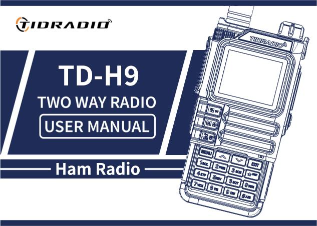

## Relevant references to the manual

**. md**:|[**RU**](TD-H9_manual.ru.md) | [**EN**](TD-H9_manual.en.md)   
**. docx**:|[**RU**](TD-H9_manual.ru.docx) | [**EN**](TD-H9_manual.en.docx)

## Contents

* [Preface](#предисловие)
  + [1.1 Safety information for amateur radios](#11-информация-по-безопасности-для-любительских-раций)
  + [1.2 Basic opportunities](#12-основные-возможности)
  + [1.3 Service (briefly)](#13-обслуживание-кратко)
* [2. Battery battery](#2-аккумуляторная-батарея)
  + [Charging.](#21-зарядка)
  + [Charger and precautionary measures](#2223-зарядное-устройство-и-меры-предосторожности)
  + [How to charge](#24-как-заряжать)
  + [2.5 LED RAM indicator](#25-светодиодный-индикатор-зу)
  + [Battery storage](#26-хранение-аккумулятора)
  + [Charging via USB-C](#27-зарядка-через-usb-c)
* [3. Installation of accessories](#3-установка-аксессуаров)
* [4. Radio station review](#4-обзор-радиостанции)
  + [Buttons and controls](#41-кнопки-и-органы-управления)
  + [4.2 LCD display. Badges](#42-жк-дисплей-значки)
  + [LED indicators](#43-светодиодные-индикаторы)
  + [Main control keys](#44-основные-клавиши-управления)
  + [Additional key combinations and inclusions](#45-дополнительные-комбинации-клавиш-и-включения)
  + [4.6 Digital keyboard](#46-цифровая-клавиатура)
* [5. Basic operations](#5-базовые-операции)
  + [Inclusion](#51-включение)
  + [5.2 Loudness](#52-громкость)
  + [5.3 Choice of channel](#53-выбор-канала)
  + [5.4 Challenge](#54-вызов)
  + [5.5 Frequency mode (VFO)](#55-частотный-режим-vfo)
  + [Channel mode (MR)](#56-канальный-режим-mr)
* [6. Additional functions](#6-дополнительные-функции)
  + [Frequency scanning](#61-сканирование-частот)
  + [Scanning of channels](#62-сканирование-каналов)
  + [Scanning of CTCSS/DCS](#63-сканирование-ctcssdcs)
  + [6.4 Manual channel programming](#64-программирование-каналов-вручную)
  + [Emergency Alert (Emergency Alert)](#65-аварийный-сигнал-emergency-alert)
  + [6.6 FM radio](#66-fm-радио)
  + [6.7 NOAA weather](#67-noaa-погода)
  + [6.8 Repiter tone (1000 / 1450 / 1750 / 2100 Hz)](#68-тон-репитера-1000--1450--1750--2100-гц)
  + [6.9 Call function (Bluetooth calls)](#69-функция-вызова-bluetooth-звонки)
  + [6.10 Audio function (music via radio)](#610-функция-аудио-музыка-через-рацию)
  + [6.11 OD PTT (Odmaster PTT)](#611-od-ptt-odmaster-ptt)
  + [6.12 Bluetooth programming](#612-программирование-по-bluetooth)
* [7. Work on the menu](#7-работа-с-меню)
  + [7.1 Substantive use](#71-основное-использование)
  + [7.2 Short teams (shortcuts)](#72-короткие-команды-шорткаты)
  + [7.31 Radio Setting (radio settings)](#731-radio-setting-настройки-радио)
  + [7.32 Program Channel (Channel Programming)](#732-program-channel-программирование-канала)
  + [7.33 Analog Set](#733-analog-set)
  + [7.34 Radio Information](#734-radio-information)
  + [7.35 Scan (Scan)](#735-scan-сканирование)
  + [7.36 Bluetooth](#736-bluetooth)
  + [7.37 Firmware update](#737-обновление-прошивки)
  + [7.38 GNSS (GPS)](#738-gnss-gps)
  + [7.39 Site Type (Position Type)](#739-site-type-тип-позиции)
  + [7.40 APRS](#740-aprs)
  + [7.41 Detailed description of APRS functions](#741-подробное-описание-функций-aprs)
  + [7.42 Remote control of APRS repeater](#742-удаленное-управление-репитером-aprs)
  + [7.43 Retransmission of APRS packets by digipiter](#743-ретрансляция-aprs-пакетов-дигипитером)
  + [7.44 APRS Worldwide Frequency](#744-aprs-worldwide-частоты)
  + [7.45 Similar to APRS radio](#745-схожая-по-функционалу-aprs-радиостанция)
  + [7.46 SMS](#746-sms)
  + [7.47 Spectrum](#747-spectrum)
  + [7.48 Morse](#748-morse)
* [Annex A. Fault detection and repair](#приложение-a-поиск-и-устранение-неисправностей)
* [Annex B: Technical specifications](#приложение-b-технические-характеристики)
* [Annex C: Table of DCS codes](#приложение-c-таблица-dcs-кодов)
* [Annex D. Table of CTCSS tones](#приложение-d-таблица-ctcss-тонов)
* [Annex E. Software](#приложение-E-программное-обеспечение)
* [Annex F. Channels and presets](#приложение-F-каналы-и-пресеты)

---

## Preface

Thank you for purchasing the TD-H9 radio. It is a multifunctional amateur (ham) radio station, combining the latest radio technology with a strong mechanical design. The TD-H9 is an ideal and effective solution for professionals who need to keep in touch with the work team (construction sites, buildings, exhibitions, hotels, etc.), as well as for users who need communication for leisure and family.

**Important notice.**To protect yourself from injuries and damage to property that may occur if misused, read the manual carefully before use. It contains instructions for safe use, as well as information on awareness and control of exposure to radiofrequency energy.

### 1.1 Safety information for amateur radios

Your portable radio station contains a low-power transmitter. When you press tangents (talk buttons), it emits radio frequency signals. The device is designed to work with a filling factor of not more than 50%. In August 1996, the FCC adopted recommendations on the effects of RF radiation with safety levels for portable wireless devices.

**FCC Warning (Part 15.21)**The manufacturer is not responsible for any changes or modifications not expressly approved by the party responsible for conformity. Such changes may nullify the user's right to operate the equipment.

**Compliance with FCC requirements (Part 15)**This equipment has been tested and found to comply with the Class B digital device restrictions under Part 15 of the FCC Regulations. These restrictions are intended to provide reasonable protection against harmful interference in living quarters. The equipment generates and can emit radio frequency energy. There is no guarantee that interference will not occur in a particular installation. Check interference is made by turning off and on the device (see the list of measures: change the orientation / location of the antenna, increase the distance between the devices, connect the device to another outlet, contact the seller or specialist).

**WARNING!**Modification of the device for receiving signals of cellular radio phones is prohibited by the rules of the FCC and federal law.

**EU compliance.**The product complies with the requirements of Directive 2014/53/EU. NOTE: European users must have a valid amateur license to transmit at frequencies and power levels. Non-compliance may be illegal and may result in prosecution.

**Compliance with RF exposure standards.**The device conforms to: FCC 47 CFR §§ 1.1307, 1.1310 and 2.1093; ANSI/IEEE C95.1:2005; Canada RSS102 Issue 5 (March 2015); IEEE C95.1:2005 Edition.

**Information on RF exposure.**Do not allow children to use the radio without adult supervision. Use only a complete or approved antenna; a damaged antenna may cause a slight burn when in contact with the skin. When working head-to-face, keep the radio 1 inch (2.5 cm) away from your face. For wearing on the body, use a complete waist clip.

### 1.2 Basic opportunities

* Power output: up to 10 W (three levels: high, medium, low).
* Ranges (TX/RX): 136–174 (VHF), 174–245 (SatCom), 240–260, 290–350 (River), 350–400, 400–470 (UHF), 470–520, 520–600 MHz. Reception: 50–76, 65–108 (FM radio), 108–136 (AM/FM, air).
* 199 memory channels.
* 50 CTCSS tones and 105 DCS codes.
* Noise suppressor with 9 levels.
* Frequency step: 0.5 / 2.5 / 5.0 / 6.25 / 10.0 / 12.5 / 25.0 / 50.0 kHz.
* VOX (voice transmission).
* TOT (Transmission Limitation Timer).
* Double observation / double reception / dual-band radio.
* Energy saving.
* The alarm function (Alarm).
* DTMF function, 1750 Hz tone for repeaters.
* Programmable repetitor offset.
* Configurable side key functions (PF1/PF2).
* 1.77-inch color LCD screen, 3 display modes, 18 menu colors.
* Microphone amplification, frequency hopping (FHSS), scrambler.
* Scan function, spectroanalyzer, LED flashlight.
* BCL (Blocking with a busy channel)
* Setting and storing channel names.
* VOICE is the voice-over of the selected function.
* Selection of channel/frequency mode.
* Keyboard lock, Roger Beep.
* Display when enabled, charging and programming via USB-C, Kenwood 2-pin connector.
* Antenna connector on the SMA-Male radio, on the SMA-Female antenna.
* Support for NOAA weather reception (US and Canada).
* GPS, Bluetooth (set up via Odmaster, headsets), APRS.
* CPU 240 MHz, RAM 120 MB, flash 16 MB, Beken BK4819, MK PY32F003.
* Dimensions: 140×53×32 mm, weight 190 g

### 1.3 Service (briefly)

* Do not open the radio - this will void the warranty.
* Do not store under the sun and in hot places, in dust and dirt.
* Don't let any moisture get in.
* If you smell or smoke, turn off the power immediately and remove the battery.
* Don't pass without an antenna.

---

## 2. Battery battery

> BP-9 7.4V DC Li-ion 2400 mAh 17.76 Wh

> Charger: 5V 1A

### Charging.

The lithium-ion battery is not charged from the factory – charge it before use. To reach full capacity, the first 2-3 cycles of discharge / charge may not give full capacity.

### Charger and precautionary measures

Only use the brand name. Do not close the contacts of the battery, do not throw it into the fire, do not remove the case. Charge at a temperature of 5–40 °C. Turn off the radio before charging. Do not charge a fully charged battery.

### How to charge

1. Connect the adapter to the socket, then to the DC connector on the back of the ROM (the indicator flashes orange).
2. Install the battery or walkie-talkie in the ZU (the indicator is red - charging is underway).
3. Full charging is 2-5 hours; when the green lights up, the charging is completed. Remove the device.

When charging the radio**switched on**The green indicator will not light up - the radio should be turned off.

### 2.5 LED RAM indicator

| Status. | Indicator | Colour |
| --- | --- | --- |
| No battery. | Green and red alternately |  |
| Regular charging. | Red. | 🔴 |
| Full charge. | Green. | 🟢 |

### Battery storage

* Store at ~80% discharge. In a dry cool place, away from heat and direct sun.

### Charging via USB-C

1. Turn off the radio.
2. Connect the USB-C cable to the battery connector, the second end to the network ROM.
3. Full charge of the empty battery is 4 hours; the battery indicator on the screen shows the process.
4. It is recommended to charge when the radio is turned off. Remove the radio from charging within 6 hours after charging; do not store connected to the RAM.

---

## 3. Installation of accessories

* **Antenna:**Clockwise, roll against the clockwise (for the base).
* **Belt clamping:**two screws on the back side above the battery - unscrew, clamp, twist back.
* **Battery:**The walkie-talkie is off; combine the guides, move up until you click. Removal - the lock button at the bottom of the battery.
* **Headset:**Open the rubber plug and insert the plug into the MIC/SP double connector.

---

## 4. Radio station review

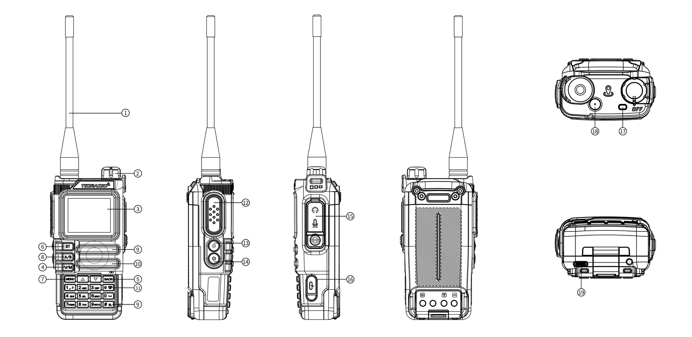

### Buttons and controls

> The numbers correspond to the figures in the diagram above.

| # | Description |
| --- | --- |
| 1. | **Antenna.** |
| 2. | **Power handle/volume**Turn on/off and adjust volume. |
| 3. | **LCD screen 1.77”.** |
| 4. | **VFO/MR**- switching "Channel mode" / "Frequent mode". |
| 5. | **BACK**- back/out. |
| 6. | **Bluetooth key**Long press on/off Bluetooth. |
| 7. | **Menou**A short tap to enter the menu. |
| 8. | **A/B**Switching the A/B bands. |
| 9. | **Dynamic.** |
| 10. | **Microphone.** |
| 11. | **DTMF/keyboard locking**Long press on / off the keyboard lock. |
| 12. | **PTT**- Tangenta: hold to speak; let go - reception. |
| 13. | **PF1 is a customizable side key 1.**: |
| - | - Short press: MENU → Radio Setting → item 27 (options: NONE, FM Radio, Lamp, TONE, Alarm, Weather, PTT2, OD PTT). |
| - | - Long press: MENU → Radio Setting → item 28 (NONE, FM Radio, Lamp, Cancel Sq, TONE, Alarm, Weather). |
| 14. | **PF2 is a customizable side key 2.**: |
| - | - Short press: MENU → Radio Setting → item 29. |
| - | Long press: MENU → Radio Setting → item 30. |
| 15. | **MIC/SP connector**- external headset. |
| 16. | **USB-C port**- programming. |
| 17. | **Indicator:**Red is transmission; green is reception. |
| 18. | **The Weather Orange Key**Enter NOAA weather mode. |
| 19. | **USB-C charging connector**battery. |

### 4.2 LCD display. Badges

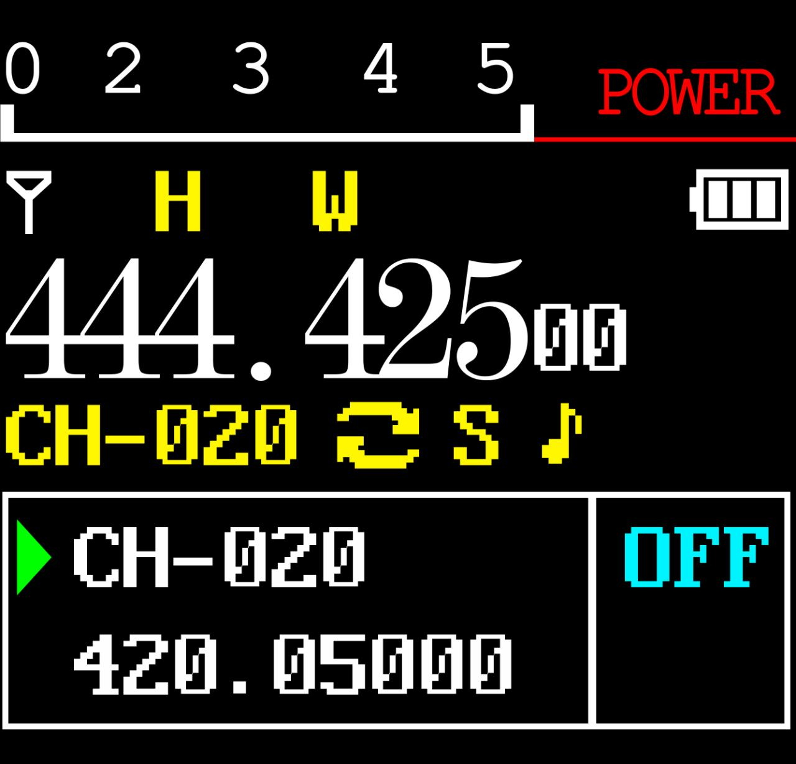

Badges in order of table from the manual:

| # | The symbol | Description |
| --- | --- | --- |
| 1. |  | Signal strength indicator (4 levels). |
| 2. |  | Высокая мощность передачи /  низкая мощность передачи. |
| 3. |  | Voice/keyboard sound (not shown if both are off) |
| 4. |  | Текущий тон: DCS или  CTCSS. |
| 5. |  | Offset "up" (TX above RX) - access to the repeater in VFO mode. |
| 6. |  | Offset "down" (TX below RX). |
| 7. |  | Dual watch is included. |
| 8. |  | Клавиатура заблокирована; удерживайте  для разблокировки. |
| 9. | [S] | Energy saving is on. |
| 10. | [N] | The channel is narrowband. |
| 11. | [W] | The channel is broadband. |
| 12. |  | Уровень заряда батареи; при разрядке  рамка значка мигает  (передача невозможна). |
| 13. |  | OD badge. |
| 14. |  | OD badge. |
| 15. |  | Bluetooth is on, not connected (white icon). |
| 16. |  | Bluetooth is connected (blue icon). |
| 17. |  | Volume indicator. |

### LED indicators

| Colour | Indicator | Radio status |
| --- | --- | --- |
| 🔴 | Always red | Transfer |
| 🟢 | Always green | Reception. |

### Main control keys

| keyboard | Description |
| --- | --- |
| **BT** | Long press: On/off Bluetooth. |
| **Menou** | Enter the menu, select an item, confirm the parameter. |
| **▲** | Pressing: step up the channel/frequency; hold more than 2 seconds: fast moving up; in scan mode: moving the scan up. |
| **▼** | Pressing: step down the channel/frequency; hold more than 2 seconds: rapid downward movement; in scan mode: moving the scan down. |
| **VFO/MR** | switching between frequency (VFO) and channel (MR) modes. Frequency storage is possible only in VFO mode. |
| **BACK** | exit from menus and functions. |
| **A/B** | switching between the top (A) and bottom (B) display; the selected one becomes active for reception and transmission. Memory storage works from display A. |
| **Digital keyboard** | input of information/choices; when transferring digital keys send the corresponding DTMF codes. |
| **# (DTMF/blocking)** | Short press: activation of the DTMF set; retention of more than 2 seconds: lock/unlock the keyboard. |

### Additional key combinations and inclusions

**Combinations with power on (Power On):**

| Combination | Function |
| --- | --- |
| PTT + \* + Inclusion | Mode Switching: GMRS/HAM/Normal |
| PTT + 1 + Inclusion | Firmware through K-cable |
| PTT + 3 + Inclusion | Firmware via USB |
| PTT + 7 + Inclusion | APRS Update |
| PF2 + Inclusion | Wireless Copy (Data Copy Mode between Similar Radio Stations) |

**Standby keys:**

| Action. | Function |
| --- | --- |
| Retention 0 | Weather. |
| Retention 1 | Frequency detector |
| Retention 3 | Scanner. |
| Retention 5 | On/off Reverse mode on channels with frequency shift of reception-transmission |
| Retention 7 | Spectroanalyzer |
| Retention 8 | Firmware via USB |
| Retention \* | Locking the keyboard (Keylock) |
| Holding # | Change of DTMF Group (1.8) |
| Holding Back | Switching between modes: radio/GNSS |

**Quick access from the main menu:**

| Action. | Function |
| --- | --- |
| Menu, 1 | Squelch Level - The noise level |
| Menu, 2. | Power - transmission power |
| Menu, 3. | Scan Mode - Scan Mode |
| Menu, 4 | Freq Step - the step of setting the frequency |
| Menu, 5. | Backlight - setting up the display backlight |
| Menu, 6 | Voice prompt - voice confirmation of commands |
| Menu, 7. | VOX |
| Menu, 8 | Broadcast Radio - FM radio stations |
| Menu, 9 | Dual Watch (TDR) - Double listening mode |
| Menu, 0 | Bandwidth - bandwidth |

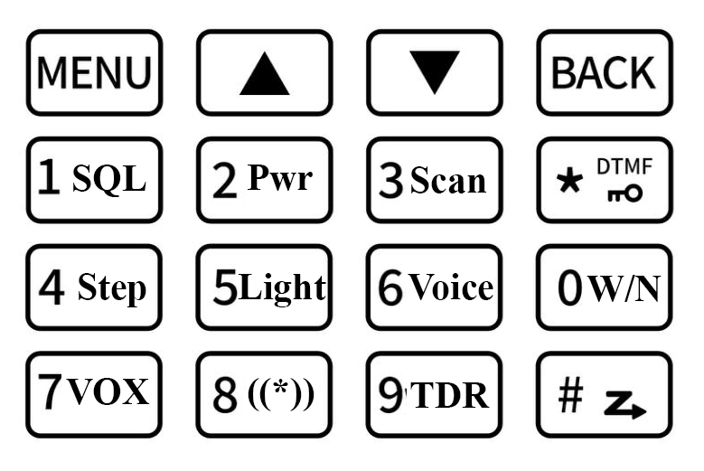

**Headset mode (Bluetooth calls):**

| Action. | Function |
| --- | --- |
| 1 | Answering the phone |
| Retention 4 | Call me back. |
| 3/PTT | Hang up. |

**Column mode (Bluetooth-audio):**

| Action. | Function |
| --- | --- |
| 1 | Previous music track |
| 2 | Losing/pausing |
| 3 | The next music track |

### 4.6 Digital keyboard

With these keys, you can enter information or select the settings on the radio.  
In Transfer Mode (TX), press the digital keys to send the corresponding DTMF code.  
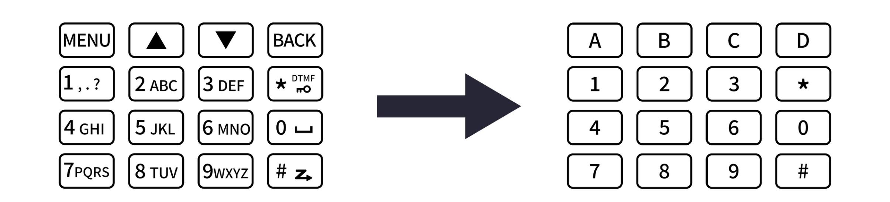

Нажмите , чтобы активировать функцию тонового набора (DTMF).   
Нажатие и удержание  более 2 секунд позволяет заблокировать или разблокировать клавиатуру.

## 5. Basic operations

### Inclusion

Turn the power/volume handle clockwise before clicking. After ~1 sec, a double beep, a message/savers display, then a frequency or channel. When the voice prompts are turned on, a mode will be announced. Turn off - counterclockwise before the click.

### 5.2 Loudness

Turn the handle clockwise.

### 5.3 Choice of channel

Two modes:**VFO (frequency)**- for experimentation and rapid programming in the field;**MR (channel)**For everyday use of pre-programmed channels. Switching keys / or encoder.

### 5.4 Challenge

* **Channel mode:**Select a channel, hold [PTT] and speak (red indicator). Reception - automatically when releasing PTT (green indicator).
* **Frequency mode:**Press [V/M], enter frequency (within range), hold [PTT].
* Keep the microphone at a distance of 2.5-5 cm from the mouth.

### 5.5 Frequency mode (VFO)

Moving the frequency with the keys ках/ках (with the step specified in the settings) or direct frequency input from the digital keyboard with an accuracy of kilohertz.

Example: 432,56250 MHz input on display A:
1. In standby mode, switch to frequency mode (VFO).
2. Enter on the keyboard: [4] [3] [2] [5] [6] [2] [5] [0].

> In VFO mode, the VFO icon is displayed. Transmission on prohibited frequencies is illegal; listening is generally permitted. Check the requirements with the local regulator.

### Channel mode (MR)

Depends on the programmed channels. Navigation - keys / or encoder. In MR mode, the channel number CH-XXX is displayed.

---

## 6. Additional functions

### Frequency scanning

1. In frequency mode, hold the key.**[3 SCAN]**more than 2 seconds - the scan will begin with a given step.
2. Stop - key**[V/M]**.
3. Settings: MENU → Scan → No. 1.

### Scanning of channels

1. Hold it in channel mode.**[3 SCAN]**more than 2 seconds.
2. The direction is the ./. keys.
3. Stop--**[V/M]**.

### Scanning of CTCSS/DCS

Standby: MENU → Scan → “SEEK DCS” – the choice of CTCSS or DCS scanning. The function is not available in channel mode; scanning will begin only when a signal is detected.

### 6.4 Manual channel programming

199 memory channels, each stores: frequency of reception, group signal (tones), channel width, ANI/PTT-ID, six-character channel name. Conservation: MENU → Program Channel → item 12 (Memory CHL).

**Modes:**VFO is frequency; MR is channel. To save, switch to VFO with VFO/MR keys.

**Example 1. Channel 31 with CTCSS tone 123.0 Hz (RX 432.55000 MHz):**1. Press [VFO/MR] - VFO mode.
2. [Menu] → Program Channel → [1] [3] [Menu] – delete previous channel data (e.g. 31) → OK.
3. [Back] → [2] [Menu] → ALTER → CTCSS → 123.0 [Menu] [Back] – choose TX tone.
4. Enter the RX frequency (43255000).
5. [Menu] → Program Channel → [1] [2] – Enter channel number (31) → [Back] – RX added.
6. Press [VFO/MR] - Return to MR mode.

**Example 2. Frequency scanning (channel 31 recording):**1. Press [V/M] - MR mode (CH-XXX icon).
2. Hold on.**[3 SCAN]**- scanning.
3. At 432.55,000 MHz, press [PTT] – stop.

### Emergency Alert (Emergency Alert)

Assign the Alarm function to the side key [PF1] or [PF2] in advance, then press this key – the radio will emit a loud signal and the flashlight will blink. The exit is press [PTT].**Attention:**Use only in a real emergency.

### 6.6 FM radio

> When you turn on the listening mode of FM radio bluetooth module is turned off.

Assign FM Radio to [PF1]/[PF2] in advance. The range is 87-108 MHz.
1. Press [PF1]/[PF2] to turn on the radio (or menu, then 8).
2. The choice of frequency - keys . / . or input.
3. Pressing again is the exit.

Note: when the signal disappears, the radio automatically returns to FM mode; when the call is switched to reception mode (configured via the menu - FM Interrupt).

### 6.7 NOAA weather

11 NOAA channels. Key: orange**weather**.
1. Press the orange key to enter NOAA mode.
2. Channel selection - ./►
3. Pressing again is the exit.

Channels: Wx-01...Wx-11 (162.5500; 162,400; 162,475; 162,425; 162,450; 162,500; 162,525; 161,650; 161,775; 161,750; 162,000 MHz). Only reception, transmission is impossible.

### 6.8 Repiter tone (1000 / 1450 / 1750 / 2100 Hz)

Assign the TONE function to [PF1]/[PF2] in advance and select the tone frequency at 24 Radio Setting. Press [PF1]/[PF2] and the repeater tone will be sent. It works even with a locked keyboard.

### 6.9 Call function (Bluetooth calls)

1. Turn on Bluetooth: MENU → Bluetooth → BT ON/OFF (or long press MENU).
2. Connect the phone (name: MENU → Bluetooth → BT Name – TD-H9xxxx).
3. Incoming call - a short press of the key**1**- answer.
4. In standby mode, long keystroke**4**- call me back.
5. During the conversation, a short press**3**or**PTT**- complete.

### 6.10 Audio function (music via radio)

1. Turn on Bluetooth, plug in your phone.
2. keyboard**1**- previous track;**3**- next track;**2**Long / short press - pause / playback.

### 6.11 OD PTT (Odmaster PTT)

1. Turn on Bluetooth (MENU → Bluetooth → BT ON/OFF or long press [MENU]).
2. Put the phone on.
3. Once connected, the PF1 side key automatically becomes the OD PTT and returns the previous function after disabling.
4. Make sure you have Receiver mode (MENU → Bluetooth → BT Mode).
5. Set OD PTT: OD (OD only) or OD+Analog (OD and similar radios at the same frequency).
6. Open the Odmaster app and join the group.
7. Press OD PTT for conversation.

**Step-by-step illustrations of OD PTT setup and operation (pages from the manual):**

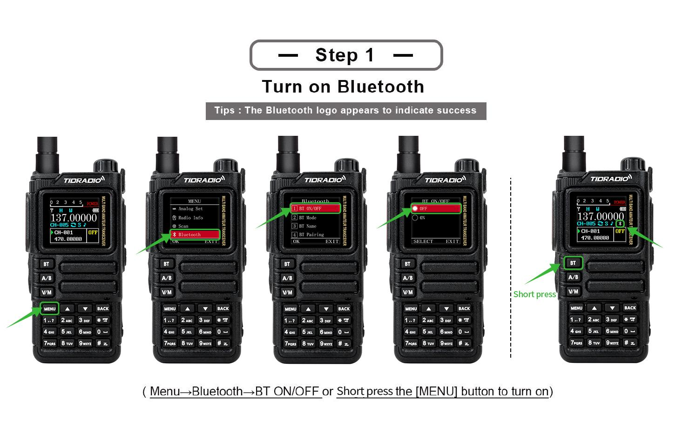
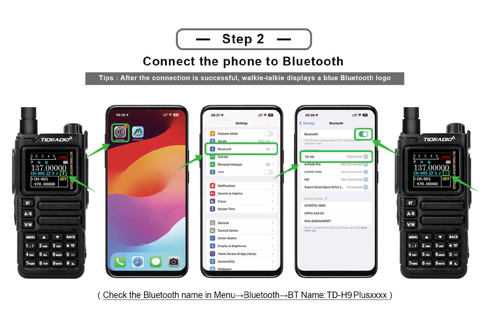
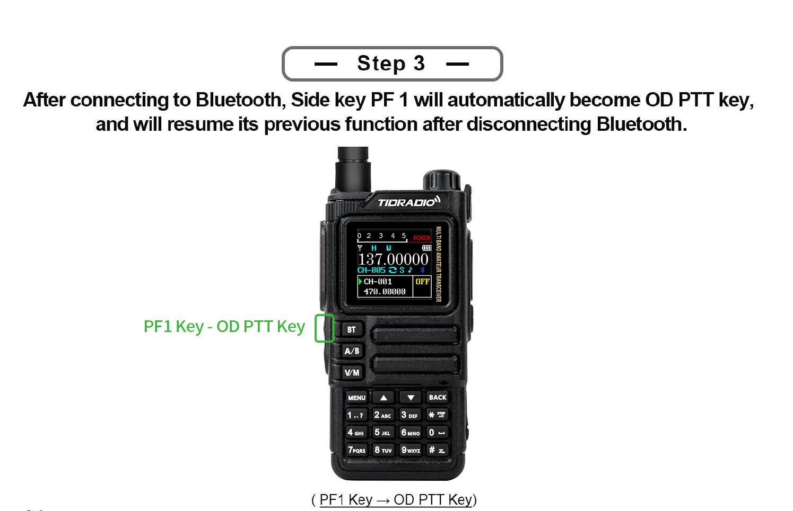
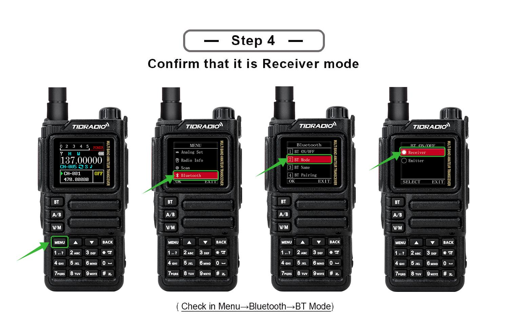
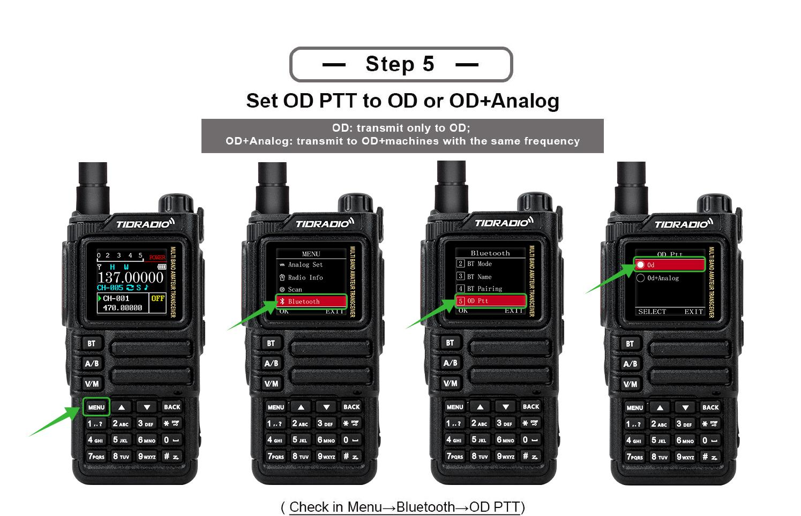
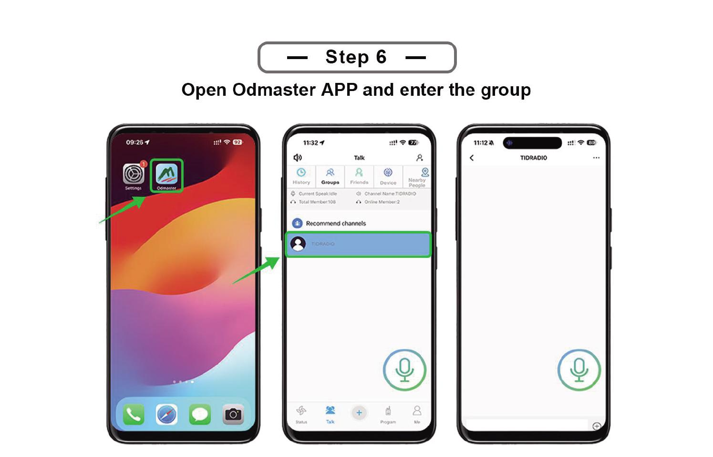
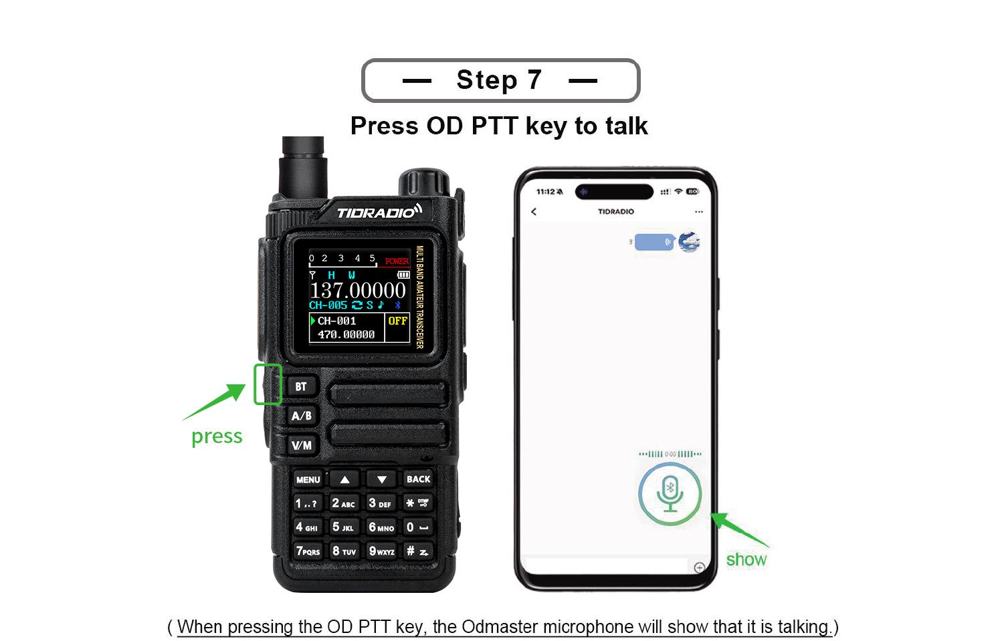

### 6.12 Bluetooth programming

(Section with step-by-step illustrations; see the original manual - programming walkie-talkie via Bluetooth connection to the software.) Connect the radio over Bluetooth and use programming software.

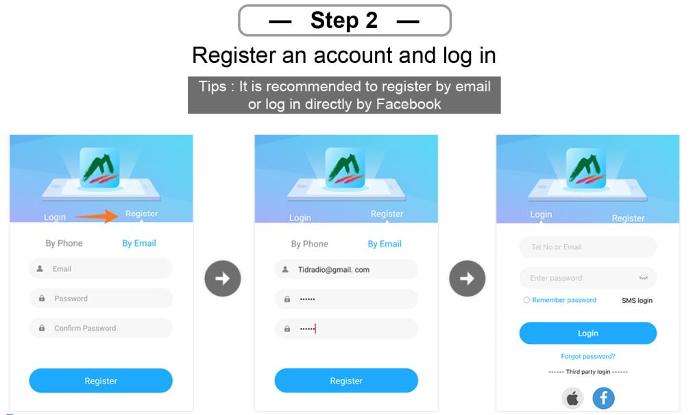
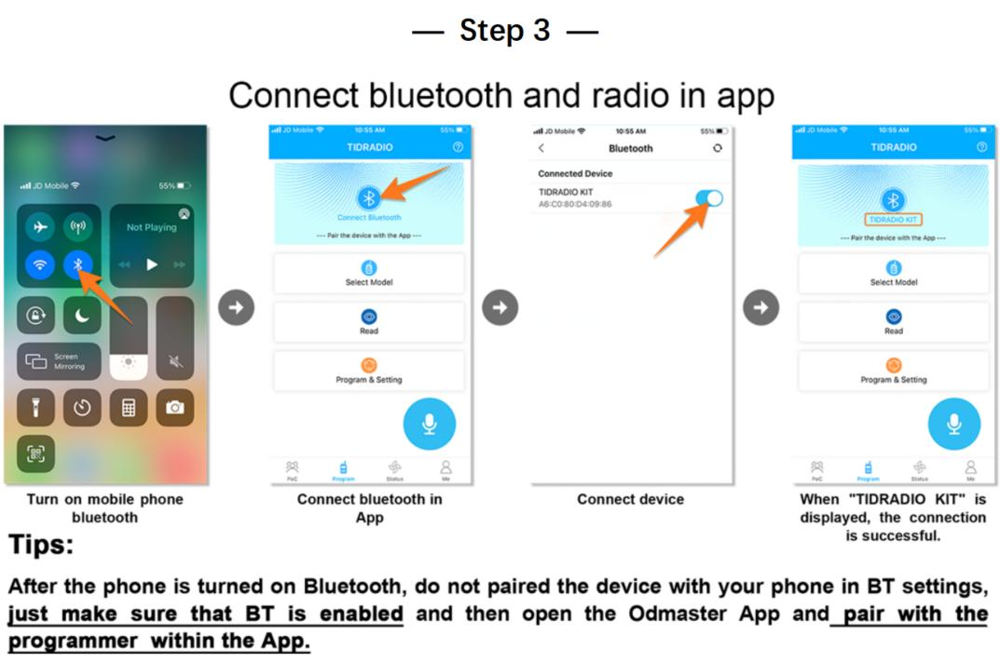
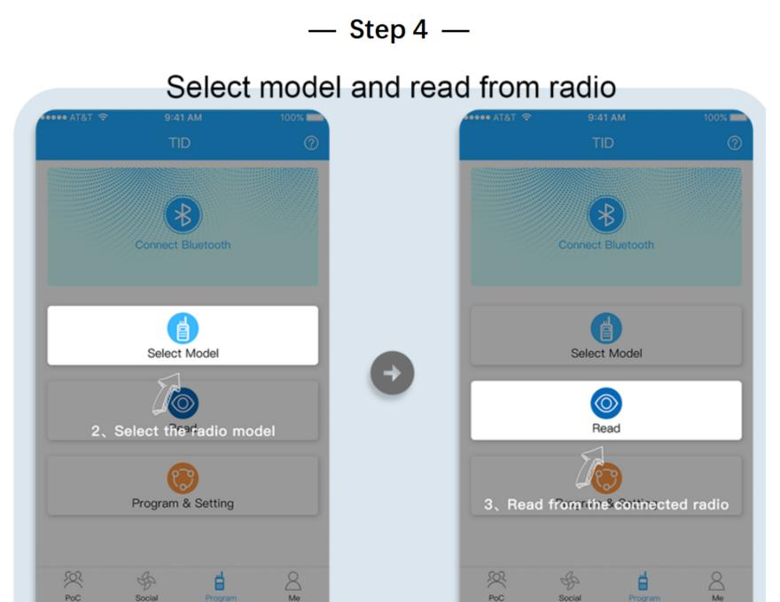

---

## 7. Work on the menu

> Channel mode is not available: CTCSS/DCS tones, channel width, PTT-ID, BCL, channel name editing.

### 7.1 Substantive use

1. Click [MENU] - Enter the menu.
2. м/м - moving to points.
3. [MENU] - item selection.
4. ./. is the choice of parameter.
5. [MENU] - confirm and return to the menu; [BACK] - cancel and exit the menu.
6. [BACK] - exit the menu at any time.

### 7.2 Short teams (shortcuts)

1. Press [MENU].
2. Enter the item number with a digital keyboard.
3. [MENU] Enter the point.
4. Parameter: ./. or numerical shortcode.
5. [MENU] - save; [BACK] - cancel.
6. [BACK] Exit.

### 7.31 Radio Setting (radio settings)

| № | Function | Description |
| --- | --- | --- |
| 1 | Squelch LV | The noise reduction level is 1–9 (1 lowest, 9 highest). Default 4. |
| 2 | Step Freq | Frequency step: 0.5/2.5/5.0/6.25/10.0/12.5/25.0/50.0 kHz. The channel mode doesn't change. |
| 3 | VOX Level | Voice activation level: Off, 1-5. |
| 4 | VOX Delay | VOX delay: 1.0/2.0/3.0 s. |
| 5 | tot | Transmission restriction timer: off/30/60/90/120/150/180/210 s. |
| 6 | Roger Beep. | Audible signal when releasing PTT. |
| 7 | Beep. | Keyboard sound. |
| 8 | Power Save | Energy saving: Off, 1:1 / 1:2 / 1:3 / 1:4 (work: sleep). |
| 9 | Keypad Lock | Automatic keyboard locking |
| 10 | Dual Watch | Listen to both channels (TDR) A and B |
| 11 | Voice | Voice confirmation of teams |
| 12 | Backlight | Timeout duration of screen illumination |
| 13 | Brightness | Screen brightness (Recommended setting: 5, with other values when transmitting and the screen on, a squeak is transmitted to the air) |
| 14 | Pwr On Disp | Welcome screen when enabled (Voltage/Message/Picture) |
| 15 | display | Display mode radio - Single (single channel), Dual and Classic (dual channel) |
| 16 | ANI-Edit | DTMF radio identifier |
| 17 | Disp Type-A | Display information about the programmed channel A (Freq + Number / Name + Number) |
| 18 | Disp Type-B | Display information about the programmed channel B (Freq + Number / Name + Number) |
| 19 | DTMF DISE | DTMF signals during transmission: OFF/ON. |
| 20 | PTT Delay | Transfer delay on PTT release |
| 21 | Language language | English/Chinese (English/Chinese) |
| 22 | Alarm Mode | On Site (local signal only, flashing flash) / TX Alarm (sound 10 s, pause 2 s, cycle). |
| 23 | Side Tone (Tail) | Tail suppression: ON/OFF (method specified by CPS). |
| 24 | Tone Burst (TBST) | Repiter tone: 1000/1450/1750/2100 Hz. Sending - side key (TONE). |
| 25 | Talk to me. | OFF: "failed to activate relay"; ON: TX = RX, on the |→| screen. |
| 26 | FM Interrupt | OFF: in FM mode, the call does not interrupt; ON: when calling, the FM is interrupted by 5 seconds. |
| 27 | PF1 S Press | Short press PF1: NONE, FM Radio, Lamp, TONE, Alarm, Weather, PTT2, OD PTT. |
| 28 | PF1 L Press | Long press PF1: NONE, FM Radio, Lamp, Cancel Sq, TONE, Alarm, Weather. |
| 29 | PF2 S Press | Short press PF2: similar to paragraph 27. |
| 30 | PF2 L Press | Long press PF2: similar to paragraph 28. |
| 31 | Top S Press | Short press of the top button: similar to paragraph 27. |
| 32 | Top L Press | Long press of the top button: similar to paragraph 28. |
| 33 | Factory R | Reset: VFO (frequency settings only), CHL (channels only), FULL (all). |
| 34 | Breath Led. | The frequency of LED flashing in standby mode. |
| 35 | MIC GAIN | Microphone amplification: 0-9. |
| 36 | DTMF Speed | DTMF speed (default 110 ms). |
| 37 | DCD | OFF: DTMF off. ON: Enable DTMF call/group call. |
| 38 | D-HOLD | DTMF Auto Reset Time: 5–60 s. |
| 39 | D-RSP | Answer DTMF: NULL / RING / REPLY / BOTH. |
| 40 | 200T X | ON: Open the 220-260 MHz band in VFO mode. |
| 41 | 350T X | ON: Open the 350-390 MHz band in VFO mode. |
| 42 | 500T X | ON: Open the top of UHF (up to 520 MHz) in VFO mode. |
| 43 | Menu Color | The color of the current menu item. |

### 7.32 Program Channel (Channel Programming)

| № | Function | Description |
| --- | --- | --- |
| 1 | RX Sub-audio | Reception tone: CTCSS (67.0–254.1), DCS (D023N–D754N), Reverse DCS (D023I–D754I). |
| 2 | TX Sub-audio | Tone of transmission: similar. |
| 3 | bandwidth | Wide (25 kHz) / Narrow (12.5 kHz). |
| 4 | TX Power | Low / Middle / High. |
| 5 | Busy Lock. | BCL: OFF - Transmission is allowed with a busy channel; ON is prohibited. |
| 6 | Call code. | 8 groups of alarm codes (edited from PC). |
| 7 | PTT-ID | Sending ANI-ID: OFF / BOT (when PTT is pressed) / EOT (when released) / BOTH. |
| 8 | Scan Add | ON is involved in the scan; OFF is not involved. |
| 9 | Scramble. | Scrambling voice (the same for both). |
| 10 | Offset | TX/RX offset: 0.000–99.998 MHz. |
| 11 | SET-D | Offset direction: OFF / Positive / Negative. |
| 12 | Memory CHL | Save the channel (save the specified parameters before recording). |
| 13 | Delete CHL | Canal removal. |
| 14 | Hopping | Frequency hopping: ON/OFF (group interference protection). |
| 15 | CH-Name | Name of channel |
| 16 | Modulation | Modulation (AM/FM) |

### 7.33 Analog Set

| № | Function | Description |
| --- | --- | --- |
| 1 | Frequency Calibration | Calibration: UHF/VHF range. |
| 2 | AM Volume Level | AM volume level: 1-5. |

### 7.34 Radio Information

| № | Function |
| --- | --- |
| 1 | Versions Info |
| 2 | APRS Info |
| 3 | User Manual |

### 7.35 Scan (Scan)

| № | Function | Description |
| --- | --- | --- |
| 1 | Scan Mode | TO/(CO)/SE (by default CO). |
| 2 | SEEK DCS | Frequency scanning with DCS/CTCSS/R-DCS. Unavailable in channel mode. |
| 3 | Hang time. | Retention time upon signal detection: step 0.5 s, default 1 s. |
| 4 | Scan Freq | Quick frequency search with one touch: 1) long press of key 1 - input; 2) е/е - channel selection for saving; 3) on the screen frequency and DCS during transmission; 4) wait for completion; 5) [Menu] - confirm / save, key \* - reshoot. |
| 5 | Freq Ranger | Scanning frequency range |
| 6 | Spectrum. | Spectroanalyzer |

### 7.36 Bluetooth

> In mode.**Receiver**The radio can act as a bluetooth column for sound/music playback.  
> In mode.**Emitter**The radio is connected to external devices: headsets, microphones, PTT.

| № | Function | Description |
| --- | --- | --- |
| 1 | BT ON/OFF | On/off Bluetooth. |
| 2 | BT Mode | Receiver (radio - receiver, connects to the phone; name TD-H9 XXXX, do not connect to the suffix BLE) / Emitter (radio - source; mating via item 4). Compatible accessories: Bluetooth PTT, MIC, headset. |
| 3 | BT Name | Name: TD-H9xxx. |
| 4 | BT Pairing | Pairable (device search: PTT, MIC, headset) / Paired (conjugated list: PTT, MIC, headset). |
| 5 | OD PTT | OD (Odmaster only) / OD + Analog (simultaneously with analog transmission). |
| 6 | OD Mode | Local Mode (radio sound; default) / Forward Mode (sending to other walkie-talkie/platforms) / Full Mode (both). |
| 7 | BT Int MIC | Bluetooth microphone amplification switch: OFF/ON. |
| 8 | BT Int Spk | Bluetooth speaker amplification switch: OFF/ON. |
| 9 | BT MIC Gain | BT microphone amplification: 1-5. |
| 10 | BT Spk Gain | BT dynamic amplification: 1-5. |
| 11 | BT Pin Code | PIN pairing: 0000 / 000000 / 123456. |
| 12 | BT Reset | ... |

#### Features of Bluetooth

A radio station can hold only one bluetooth connection. To interact with a smartphone or PC, you need to select BT Mode: Receiver mode. To connect the headset - BT Mode - Emitter.

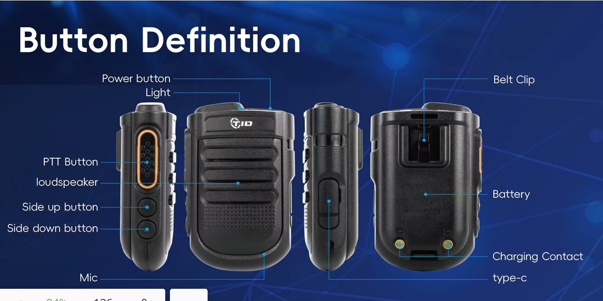

When working with[**TID-MIC**](https://tidradio.com/products/tidradio-handheld-wireless-microphone-with-bluetooth)There is a significant delay in order.*1~2. 5*seconds when pressing the tangent on the transmission and about*1~1. 5*seconds at the signal. When pressing the tangent, the audio bluetooth channel opens first, only after that the radio frequency path for transmission opens and the red indicator lights up. That should be taken into account.

When working with[**TID-PTT**](https://tidradio.com/products/tidradio-wireless-ptt-button)slack**TID-MIC**form*0.2~1*Seconds, so the radio opens faster. When connecting TID-PTT to a smartphone**ODmaster** работает с устройством **TID-PTTxxxxxx-A**(speed)*38400*baud), when pairing through the Bluetooth menu of the android, it is not recommended to mate with this device -**ODMaster** может его не увидеть. Вместо этого существует устройство  **TID-PTTxxxxxxx-B**.

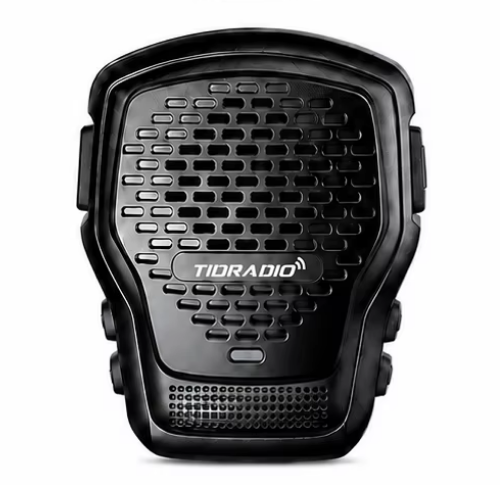

When working with[**QL-2**](https://tidradio.com/products/td-q2l-bluetooth-noise-cancelling-magnetic-mic-for-td-h3-plus-td-h9)...

### 7.37 Firmware update

1. Enter:[web.odmaster.net](https://web.odmaster.net/).
2. Remote Control Program: Upgrade Firmware
3. Follow the steps on the screen.

Either.

1. Open up.<Firmware>
2. Download the drivers and the current version of the firmware
3. Follow the instructions in the archive

> Important: Update APRS firmware erases all settings. Callsign, APRS configuration, channel frequencies, digipeater paths - everything disappears!

There are two ways to connect a walkie-talkie to a computer for programming and firmware updates. The first is a USB-C data port on the side of the case, next to the K-1 tangent connectors. The second is the CH340 programming cable, which connects to the same K-1 connectors and connects to the computer via USB-A.

### 7.38 GNSS (GPS)

| № | Function | Description |
| --- | --- | --- |
| 1 | GPS ON/OFF | On/off GPS. |
| 2 | GPS Information | Antenna, longitude, latitude, date, time, altitude, course, speed, satellites. |
| 3 | Position | (D) / DM / DMS – Deg, Deg.min, Deg.min.s. |
| 4 | Time zone | Time zone UTC-12...UTC+12 (default +3). |
| 5 | Speed Unit | Speed units: (Kmph) / Knot / Mpt. |
| 6 | Distance Unit | Distance units: (Km)/Sea/Mile. |
| 7 | Altitude Unit | Height units: (M)/Ft. |
| 8 | Fixed Latitude | Fixed latitude (example 44° 35' 04" - а/а selection, [#] confirmation). |
| 9 | Fixed Longitude | Fixed longitude (example 40° 06' 38). |
| 10 | Fixed Altitude | Fixed height (default 0). |

### 7.39 Site Type (Position Type)

* **Fix Coordinates**- fixed coordinates.
* **GPS Coordinates**- GPS coordinates.

Fixed coordinates are transmitted in case of activation of the beacon transmission mode via APRS, if the appropriate setting is enabled.
GPS coordinates - when the location was determined.

If the radio station is stationary, you can turn off GPS and the station will send the specified coordinates (menu items 7.38.8 Fixed Latitude, 7.38.9 Fixed Longitude and 7.38.10 Fixed Altitude).

### 7.40 APRS

> When working with APRS, it is advisable to completely turn off the energy saving mode so as not to miss the start of the package.

| № | Function | Description |
| --- | --- | --- |
| 1 | APRS Switch | On/off APRS. |
| 2 | Beacon Set | Lighthouse setting: |
| 2. 1st | .. | **Call Sign**- Amateur radio call sign (up to 6 characters, capital Latin + digits; итель/итель character selection, confirm - input, back - deletion, # - save) |
| 2. 2. | .. | [**SSID**](http://aprs.ru/index.php/SSID)(0-15, default 11) |
| 2. 3 | .. | [**SSID Symbol**](https://www.aprs.org/symbols.html) (`/`or`\`according[table](Customer%20Programming%20Software/Disasm/APRS_symbols.md) |
| 2. 4. | .. | **Custom Information**Commentary on the APRS package, up to 60 ASCII characters |
| 2. 5 | .. | [**Icon Settings**](Customer%20Programming%20Software/Disasm/APRS_symbols.md)- the reference book viewed according to[table](Customer%20Programming%20Software/Disasm/APRS_symbols.md). Use it to find the desired character, then enter the code into the SSID Symbol. |
| 2. 6 | .. | **MIC Start**(On/Off) |
| 2. 7 | .. | **MIC Type**(MO: Off Duty / M1: En Route / M2: In Service / M3: Returning / M4: Committed / M5: Special / M6: Priority / M7: Emergency) |
| 2. 8. | .. | [**Route 1**](Docs/APRS_Digipeater_ru.md): Use the а/а button to select the symbol. Press the confirmation button to select it. If you make a mistake, press the return button to delete. |
| 2. 9. | .. | [**Route 1 Count**](Docs/APRS_Digipeater_ru.md): (0-9) |
| 2. 10. | .. | [**Route 2**](Docs/APRS_Digipeater_ru.md): Use the а/а button to select the symbol. Press the confirmation button to select it. If you make a mistake, press the return button to delete. |
| 2. 11. | .. | [**Route 2 Count**](Docs/APRS_Digipeater_ru.md): (0-9) |
| 2. 12. | .. | **Report Voltage**Send information about the battery (on default) |
| 2. 13 | .. | **Report Sats**Send satellite information (on default) |
| 2. 14. | .. | **Report Mileage**Send mileage information (OFF default) |
| 3 | Beacon Type | Beacon transmission setting: |
| 3. 1st | .. | **PTT Linkage**(Beacon at each PTT press/release; default OFF) |
| 3. 2. | .. | **Timed Beacon**- send information at a given frequency (on default) |
| 3. 3 | .. | **Timing.**an interval in seconds, e.g. 0090 = every 90 seconds (digit input + [#]). |
| 4 | Relay Set | Settings of APRS-repiter mode: |
| 4. 1st | .. | **DIGI Forward CH**To which channel to relay packets (A/(B)/AB) |
| 4. 2. | .. | **DIGI1 Enable**(OFF default) |
| 4. 3 | .. | **DIGI1 Name**(default WIDE1), up to 6 ASCII characters: capital letters and numbers |
| 4. 4. | .. | **DIGI2 Enable**(OFF default) |
| 4. 5 | .. | **DIGI2 Name**(default WIDE2), up to 6 ASCII characters: capital letters and numbers |
| 4. 6 | .. | **Wait Before Forwarding**Delay before retransmission (0-9c). In the presence of several repeaters allows you to divide the transmission time and avoid collisions of beacons in the air |
| 4. 7 | .. | **Remote Password**Remote repeater control password via KISS (TNC) (default 123456). |
| 5 | Advanced Set | Advanced reception/transmission settings: |
| 5. 1st | .. | **APRS RX CH**On which channel to take APRS (OFF/A/(B)) |
| 5. 2. | .. | **APRS TX CH**On which channel to transmit APRS (OFF/A/(B)) |
| 5. 3 | .. | **PTT Priority**Priority for simultaneous voice/APRS (Talk/APRS) |
| - | .. | **RX Decode Tone**Audible signal with successful reception and decoding of APRS (on default) |
| - | .. | **TX Tone**- audible signal when transmitting APRS (by default OFF) |
| 5. 4. | .. | **Beacon Auto Popup**(on default) - display the screen with information about the received beacon |
| 6 | Beacon List | List of beacons: up to 100 accepted; control/removal. |
| 7 | APRS Reset | Reset APRS to factory settings. |

### 7.41 Detailed description of APRS functions

| # | Topeka | Description |
| --- | --- | --- |
| 1 | **APRS Channels** | A/B channels can be assigned to APRS or voice; modes are supported: |
| . | .. | - reception + transmission to A |
| . | .. | Receiving A/transmitting B (cross-repeater) |
| . | .. | - Just A. |
| . | .. | - simultaneous transmission A and B |
| . | .. | - reception + transmission to B |
| . | .. | - reception B / transmission A (cross-repiter) |
| . | .. | - Only B. |
| . | .. | Work is supported offline (without the Internet and cellular communication) - radios determine each other's positions directly. |
| 2 | **Bluetooth** | Support for KISS TNC over Bluetooth; data can be parsed and displayed or uploaded to the network via Odmaster. |
| 3 | **APRS Relay (DIGI)** | Full DIGI relay with customizable names; on/off remotely. |
| 4 | **MIC-E** | Beacons are compressed and transmitted in MIC-E format - shorter airtime, fewer collisions, higher probability of successful decoding. |
| 5 | **PTT Delay** | Customizable delay between pressing PTT and starting transmission (useful with a slow noise suppressor of a remote station). |
| 6 | **APRS Digital Relay** | Two repeater names: by default WIDE1 and WIDE2 (up to 6 characters, numbers or capital letters). Rule: when receiving a valid beacon containing the repeater name and the transition counter > 1, the radio sends the packet once, reducing the counter by 1. With the counter 0, the packet is not sent. Each transition is a complete cycle of reception → decode → recoding → transfer. The counter limits infinite propagation.[Details...](http://wa8lmf.net/DigiPaths/) |
| 7 | **Deleted password** | By default.**123456**(6 digits). |
| 8 | **Fixed station** | With the Fix Coordinates type, given coordinates are used to calculate the distance/pelling. |
| 9 | **Maps/track viewing** | ... |
| . | Odmaster: | - https://web.odmaster.net/login. |
| . | APRS.fi. | - https://aprs.fi/ |
| . | APRS.to. | - https://aprs.to/ |
| . | APRS Map Info | - https://aprs-map.info/ |

> PTT Linkage and Timed Beacon transmissions cannot be enabled at the same time. If both are included, the Timed Beacon does not work.
>
> The bandwidth for APRS should be Wide!

### 7.42 Remote control of APRS repeater

You can send a control packet from any other radio station or smartphone connected to the transceiver as a standard APRS Message addressed to the call sign of your radio station (for example, N0CALL-9). A combination of [password][command] (e.g., 123456A1) is entered in the message text. If the radio station successfully receives and decodes the package, it will change the operating mode of the built-in digipiter.

The password should strictly consist of 6 digits. For the tracker to execute the command, the message must contain your password and then the command itself (without spaces).

Available remote commands:
|Team |What's going on |
|---|---|
|A1|Insert repeater 1 (DIGI 1 - activation of digipiter function)|
|A0| Turn off repeater 1 (DIGI 1)|
|B1|Insert repeater 2 (DIGI 2)|
|B0| Turn off repeater 2 (DIGI 2)|
|R0|Reset the current settings and restart the device with parameters from non-volatile memory EEPROM|

### 7.43 Retransmission of APRS packets by digipiter

[APRS relay](Docs/APRS_Digipeater_ru.md)It is a process: reception → decoding → recoding → sending. With each relay, the signal quality remains the best, unlike traditional analog voice relays.

Due to the fact that the beacon contains a specified number of retransmissions, endless retransmission does not occur.

In the digipiter mode, the radio station, when receiving an APRS packet, searches for the name of the installed digipiter in its PATH, and if it finds it, then sends this packet further to the air, decrementing the SSID per unit, but only if the SSID is greater than zero.

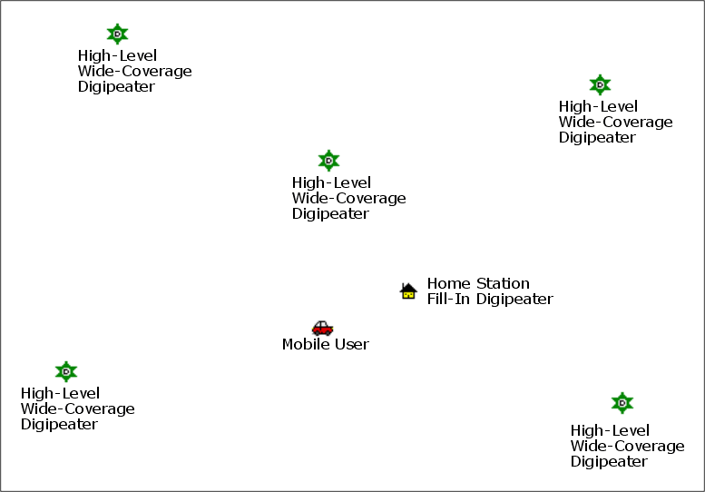

### 7.44 APRS Worldwide Frequency

| The frequency | Description |
| --- | --- |
| 144.3900 MHz | North America: United States, Canada, Chili |
| 144.3900 MHz | Indonesia, Singapore, Malaysia |
| 144.3900 MHz | Thailand (https://www.qsl.net/rast/text/2mbandplan.htm) |
| 144.3900 MHz | Mexico, Dominican Republic, Puerto Rico, Trinidad & Tobago, Columbia |
| 144.8000 MHz | Europe, UK, Ireland, Iceland,**Russia** |
| 144.8000 MHz | South Africa, Azores, Costa Rica, Israel, Lebanon, Senegal |
| 145.1750 MHz | Australia, Tasmania |
| 144.5750 MHz | New Zealand |
| 144.9300 MHz | Argentina, Uruguay, Paraguay |
| 144.6600 MHz | Japan |
| 144.6400 MHz | China, Hong Kong, Taiwan |
| 144.6200 MHz | South Korea |
| 145.5250 MHz | Thailand (OLD) |
| 145.5700 MHz | Brazil |
| 433.8000 MHz | Europe (Primary) |
| 432.5 MHz | Europe (Secondary) |
| 439.1000 MHz | Australia |
| 430.5125 MHz | Netherlands |
| 432.5750 MHz | New Zealand |

> Do not use the above frequencies for voice transmission.

http://aprs.qrz.ru/freq.php  
https://www.sigidwiki.com/wiki/Automatic Packet Reporting System (APRS)  
https://aprs.fi/

### 7.45 Similar to APRS radio

**Significant disadvantages of APRS implementation on H9**:
\* Inability to assign beacon by pressing the side key (Send Beacon)
Ability to silence the sound on the APRS channel (Mute A/B)
\*Not able to work with APRSDroid, only ODMaster

A similarly functional APRS radio station**Lanchonlh HG-UV98**:
\*[HG-UV98](https://github.com/dkxce/HG-UV98)
\* [lanchonlh hg-uv98 ru manual](https://github.com/dkxce/lanchonlh_hg-uv98_ru_manual)

> The HG-UV98 has better bandwidth filters than the H9. The H9 has better APRS selectivity.
>
> For the correct interaction with**Lanchonlh HG-UV98**need to adjust**APRS RX Level**UV98.

### 7.46 SMS

> When working with SMS, you need to turn off Dual Watch (TDR) mode and it is desirable to remove the power saving mode.

The radio station allows you to send and transmit short messages between similar stations:**TD-H9**and TD-H3+.  
Send and receive messages via APRS.

> In RF mode, messaging is only possible between**TD-H9**and TD-H3+. The recipient is indicated by Radio Info (Radio Info -> Radio ID).
> Radio ID is configured via CPS (DTMF Code -> DTMF Settings -> Local ID).
>
> При режиме работы APRS обмен сообщениями осуществляется APRS-пакетами Message (:). Получатель и отправитель на всплывающем экране при этом отображается правильно.
> На экране просмотра входящих SMS в качестве получателя указан отправитель.
> 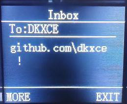

| Item | Name | Description |
| --- | --- | --- |
| 1 | SMS ON/OFF | On/off SMS reception mode |
| 2 | Send SMS | Sending a message to the recipient. Amateur radio call sign with SSID suffix is indicated as the recipient of the message. |
| 3 | Inbox | Incoming communications |
| 4 | Outbox | Outgoing communications |
| 5 | Draft | Communication templates |
| 6 | SMS Mode | SMS mode (RF/R)[APRS](https://www.aprs.org/aprs-messaging.html)) |
| 7 | RX Filter | Message filter |
| 8 | Statisctics | Message statistics (memory use) |

### 7.47 Spectrum

The radio station allows you to view the radio frequency spectrum.  

| Management | Description |
| --- | --- |
| Retention 7 | Entry into spectrum analyzer mode |
| Menou | Entrance to the text menu of spectrometer settings |
| BACK/EXIT | Quick exit from spectrum analyzer mode |
| PF1 | Exclusion of frequency from scanning (Perhaps you need to reset to spectrum mode, or reset peak values)**0**) |
| PF2 | Including frequency in the scan |
| # | Automatic transition of the cursor to the peak of the strongest signal |
| 2/8 (retention) | Change of the RSSI threshold (Threshold) |
| / | Frequency navigation (cursor movement) |
| \* | On/off cursor |
| PTT | Monitor Mode (MONI) – Instant opening of the noise suppressor to listen to the frequency under the cursor |
| 0-9 | Manual central frequency input |

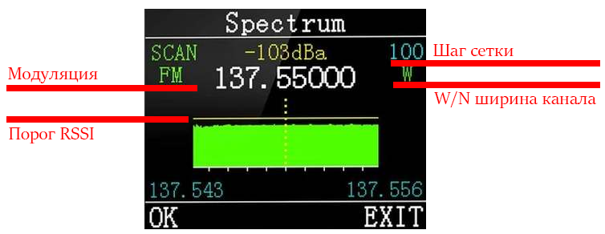

**menu**:

| Item | Name | Description |
| --- | --- | --- |
| 1 | Modulation | Modulation change |
| 2 | Step Freq | Changing the step of the scanning frequency grid 0.1/0.5/1.0/2.5/5.0/6.25/10.0/12.5/25.0/50/100 kHz |
| 3 | Threshold | RSSI threshold (minimum signal strength in decibels (dBm)) |
| 4 | Cursor | On/off cursor |
| 5 | bandwidth | Channel width setting (W/N) |
| 6 | Reset | Resetting spectrometer settings and cleaning cut frequencies |

### 7.48 Morse

The radio can transmit and receive Morse code. Adjustable TX speed, RX threshold and tone frequency.

| Item | Name | Description |
| --- | --- | --- |
| 1 | Morse On/Off | Morse regimen |
| 2 | Key TXX | Manual transmission mode |
| 3 | Edit TX | Entering the transmission text with sending |
| 4 | RX Code | Morse code acceptance mode |
| 5 | TXX Speed | Transmission speed for automatic 5/8/12/18 mode |
| 6 | RX Threshold | RSSI threshold (minimum signal strength in decibels (dBm)) |

> During Morsea transmission, CTCSS or DCS subtones are not transmitted.

---

## Annex A. Fault detection and repair

| Problem. | Analysis | Decision |
| --- | --- | --- |
| Not included. | Incorrectly installed battery / discharged / poor contact | Reinstall battery; charge or replace; clean contacts |
| Weak/intermittent voice when taken | Low volume / antenna weakened or installed incorrectly / clogged speaker | Increase volume; turn off and reinstall the antenna; clean the speaker |
| No connection to the group. | Frequency or signals do not match / too far | Check frequencies and signals; get closer |
| Other voices/noise heard | Interference on frequency / in analog mode no alarm | Change the frequency or raise the noise suppressor; adjust the alarm |
| No one heard (noise) | Large obstacles / open terrain / electromagnetic interference | Go to an open flat area, restart the radio; move away from sources of interference |
| Continuous transmission | VOX enabled or headset not inserted until the end | Turn off VOX; check the headset |

## Annex B: Technical specifications

| Parameter | Meaning. |
| --- | --- |
| Frequency Range (Amateur, RX & TX) | 136–173.99 and 400–519.99 MHz (TX/RX also 174–245, 240–260, 290–350, 350–400, 470–520, 520–600 MHz; RX 50–76, 65–108 (FM radio), 108–136 (AM/FM air), 220–260, 350–390 MHz |
| Memory channels | 199 |
| RF power output | up to 10 W (3 levels: high, medium, low) |
| Working voltage | DC 7.4 V ±10 per cent |
| Battery capacity | 2400 mAh (Li-Ion) |
| Frequency stability | ± 2.5 ppm |
| Operating temperature | from -20 °C to +50 °C |
| Mode of work | simplex |
| Impedance antenna | 50 ohm |
| antenna connector | On the SMA-Male radio, on the SMA-Female antenna |
| Headset connector | K-Plug (Kenwood 2-pin) |
| Display. | 1.77" color LCD, 3 display modes, 18 menu colors |
| GPS | Built-in GPS/GNSS |
| Bluetooth | Built-in (for customization through Odmaster, headsets) |
| APRS | Built-in support (KISS TNC, DIGI, MIC-E) |
| Spectroanalyzer | Built-in |
| CPU/RAM/Flash | 240 MHz / 120 MB / 16 MB |
| Radiochip/MK | Beken BK4819 / PY32F003 |
| FM modulation | [11K0F3E](Docs/emission-types-radionerds-ru.md)@ 12.5 kHz (Narrow band) /[16K0F3E](Docs/emission-types-radionerds-ru.md)@ 25 kHz (Wide band) |
| Power of the adjacent channel | 60 dB @ 12.5 kHz |
| Transmission current | ≤ 1500 mA |
| Sensitivity of the receiver | 0.25 μV (12 dB SINAD) |
| Selectivity on the neighboring channel | ≥ 55 dB @ 12.5 kHz |
| Suppression of intermodulation | ≥ 55 dB @ 12.5 kHz |
| Parasite radiation | ≤ -57 dB @ 12.5 kHz |
| Sound output | 1 Watt @ 16 Ohm |
| Reception current. | ≤ 380 mA |
| Sound distortion | ≤ 5% |
| Dimensions (without antenna) | 140 x 53 x 32 mm |
| Weight. | 190 |

## Annex C: Table of DCS codes

| № | Code. | № | Code. | № | Code. |
| --- | --- | --- | --- | --- | --- |
| 1 | D023N | 2 | D025N | 3 | D026N |
| 4 | D031N | 5 | D032N | 6 | D036N |
| 7 | D043N | 8 | D047N | 9 | D051N |
| 10 | D053N | 11 | D054N | 12 | D065N |
| 13 | D071N | 14 | D072N | 15 | D073N |
| 16 | D074N | 17 | D114N | 18 | D115N |
| 19 | D116N | 20 | D122N | 21 | D125N |
| 22 | D131N | 23 | D132N | 24 | D134N |
| 25 | D143N | 26 | D145N | 27 | D152N |
| 28 | D155N | 29 | D156N | 30 | D162N |
| 31 | D165N | 32 | D172N | 33 | D174N |
| 34 | D205N | 35 | D212N | 36 | D223N |
| 37 | D225N | 38 | D226N | 39 | D243N |
| 40 | D244N | 41 | D245N | 42 | D246N |
| 43 | D251N | 44 | D252N | 45 | D255N |
| 46 | D261N | 47 | D263N | 48 | D265N |
| 49 | D266N | 50 | D271N | 51 | D274N |
| 52 | D306N | 53 | D311N | 54 | D315N |
| 55 | D325N | 56 | D331N | 57 | D332N |
| 58 | D343N | 59 | D346N | 60 | D351N |
| 61 | D356N | 62 | D364N | 63 | D365N |
| 64 | D371N | 65 | D411N | 66 | D412N |
| 67 | D413N | 68 | D423N | 69 | D431N |
| 70 | D432N | 71 | D445N | 72 | D446N |
| 73 | D452N | 74 | D454N | 75 | D455N |
| 76 | D462N | 77 | D464N | 78 | D465N |
| 79 | D466N | 80 | D503N | 81 | D506N |
| 82 | D516N | 83 | D523N | 84 | D526N |
| 85 | D532N | 86 | D546N | 87 | D565N |
| 88 | D606N | 89 | D612N | 90 | D624N |
| 91 | D627N | 92 | D631N | 93 | D632N |
| 94 | D645N | 95 | D654N | 96 | D662N |
| 97 | D664N | 98 | D703N | 99 | D712N |
| 100 | D723N | 101 | D731N | 102 | D732N |
| 103 | D734N | 104 | D743N | 105 | D754N |
| 106 | D023I | 107 | D025I | 108 | D026I |
| 109 | D031I | 110 | D032I | 111 | D036I |
| 112 | D043I | 113 | D047I | 114 | D051I |
| 115 | D053I | 116 | D054I | 117 | D065I |
| 118 | D071I | 119 | D072I | 120 | D073I |
| 121 | D074I | 122 | D114I | 123 | D115I |
| 124 | D116I | 125 | D122I | 126 | D125I |
| 127 | D131I | 128 | D132I | 129 | D134I |
| 130 | D143I | 131 | D145I | 132 | D152I |
| 133 | D155I | 134 | D156I | 135 | D162I |
| 136 | D165I | 137 | D172I | 138 | D174I |
| 139 | D205I | 140 | D212I | 141 | D223I |
| 142 | D225I | 143 | D226I | 144 | D243I |
| 145 | D244I | 146 | D245I | 147 | D246I |
| 148 | D251I | 149 | D252I | 150 | D255I |
| 151 | D261I | 152 | D263I | 153 | D265I |
| 154 | D266I | 155 | D271I | 156 | D274I |
| 157 | D306I | 158 | D311I | 159 | D315I |
| 160 | D325I | 161 | D331I | 162 | D332I |
| 163 | D343I | 164 | D346I | 165 | D351I |
| 166 | D356I | 167 | D364I | 168 | D365I |
| 169 | D371I | 170 | D411I | 171 | D412I |
| 172 | D413I | 173 | D423I | 174 | D431I |
| 175 | D432I | 176 | D445I | 177 | D446I |
| 178 | D452I | 179 | D454I | 180 | D455I |
| 181 | D462I | 182 | D464I | 183 | D465I |
| 184 | D466I | 185 | D503I | 186 | D506I |
| 187 | D516I | 188 | D523I | 189 | D526I |
| 190 | D532I | 191 | D546I | 192 | D565I |
| 193 | D606I | 194 | D612I | 195 | D624I |
| 196 | D627I | 197 | D631I | 198 | D632I |
| 199 | D645I | 200 | D654I | 201 | D662I |
| 202 | D664I | 203 | D703I | 204 | D712I |
| 205 | D723I | 206 | D731I | 207 | D732I |
| 208 | D734I | 209 | D743I | 210 | D754I |

## Annex D. Table of CTCSS tones

| № | Hz | № | Hz | № | Hz | № | Hz | № | Hz |
| --- | --- | --- | --- | --- | --- | --- | --- | --- | --- |
| 1 | 67.0 | 2 | 69.3 | 3 | 71.9 | 4 | 74.4 | 5 | 77.0 |
| 6 | 79.7 | 7 | 82.5 | 8 | 85.4 | 9 | 88.5 | 10 | 91.5 |
| 11 | 94.8 | 12 | 97.4 | 13 | 100.0 | 14 | 103.5 | 15 | 107.2 |
| 16 | 110.9 | 17 | 114.8 | 18 | 118.8 | 19 | 123.0 | 20 | 127.3 |
| 21 | 131.8 | 22 | 136.5 | 23 | 141.3 | 24 | 146.2 | 25 | 151.4 |
| 26 | 156.7 | 27 | 159.8 | 28 | 162,2 | 29 | 165.5.5 | 30 | 167.9 |
| 31 | 171.3 | 32 | 173.8 | 33 | 177.3 | 34 | 179.9 | 35 | 183.5 |
| 36 | 186.2 | 37 | 189.9 | 38 | 192.8 | 39 | 196.6.6 | 40 | 199.5 |
| 41 | 203.5 | 42 | 206.5 | 43 | 210.7 | 44 | 218.1 | 45 | 225.7 |
| 46 | 229.1 | 47 | 233.6 | 48 | 241.8 | 49 | 250.3.3 | 50 | 254.1.1 |

## Annex E. Software

| soft | Reference |
| --- | --- |
| Drivers. | <Drivers> |
| Setting up a PC radio | [TIDRadioCPS](Customer%20Programming%20Software) |
| Setting up the radio on Android | [Odmaster](https://play.google.com/store/apps/details?id=com.tid.walkie) |
| Alternative APRSDroid | [APRSDroid 9M2PJU Mod](https://aprsdroid.hamradio.my/) |
| Android javAPRSSrvr IGate | [javAPRSSrvr IGate](https://www.ae5pl.net/javAPRSSrvrIGate.aspx) |
| Software and firmware | <Firmware> |
| Online channel editor | [**TD Editor**](https://dkxce.github.io/temporary/td-h9/td-editor.html) |
| APRS software for PC | [**Desktop BLE-TCP Bridge Software**](https://github.com/dkxce/tdh9desktop) |
| APRS software for Android | [**Android BLE-TCP Bridge Software**](https://github.com/dkxce/tdh9android) |
| Other software (APRS) | [github.com/dkxce](https://github.com/dkxce?tab=repositories&q=aprs) |
| Description of the .td format | [DISAMS](Customer%20Programming%20Software/Disasm) |

## Annex F. Channels and presets

* <Presets>

---

*Translated from the official manual TIDRADIO TD-H9 (Ham Version).  
Official website: https://tidradio.com/.  
Legal information and full illustrations in the original manual.*