<!-- markdown-translator:e63b41d61fcc1e8edc922b7cb8949abe4553a3b950a7f0ba643a93efa26bc008 -->
# TIDRADIO TD-H9 - User Manual

**Firmware 1.0.33**- Translation of the official user manual ([Ham Version, 71 p.](Original%20Manuals/H9_Ham_Version_User_Manual.pdf)), modified and expanded (v4).

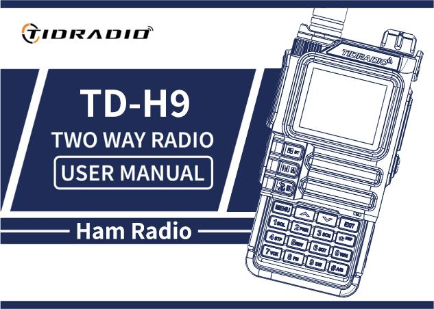

## Content

* [Preface](#предисловие)
  * [1.1 Safety information for amateur radios](#11-информация-по-безопасности-для-любительских-раций)
  * [1.2 Main features](#12-основные-возможности)
  * [1.3 Maintenance (briefly)](#13-обслуживание-кратко)
* [2. Battery](#2-аккумуляторная-батарея)
  * [2.1 Charging](#21-зарядка)
  * [2.2–2.3 Charger and precautions](#2223-зарядное-устройство-и-меры-предосторожности)
  * [2.4 How to charge](#24-как-заряжать)
  * [2.5 Charger LED indicator](#25-светодиодный-индикатор-зу)
  * [2.6 Battery storage](#26-хранение-аккумулятора)
  * [2.7 Charging via USB-C](#27-зарядка-через-usb-c)
* [3. Installation of accessories](#3-установка-аксессуаров)
* [4. Radio station overview](#4-обзор-радиостанции)
  * [4.1 Buttons and controls](#41-кнопки-и-органы-управления)
  * [4.2 LCD display. Badges](#42-жк-дисплей-значки)
  * [4.3 LED indicators](#43-светодиодные-индикаторы)
  * [4.4 Basic control keys](#44-основные-клавиши-управления)
  * [4.5 Additional key combinations and activations](#45-дополнительные-комбинации-клавиш-и-включения)
  * [4.6 Numeric keypad](#46-цифровая-клавиатура)
* [5. Basic Operations](#5-базовые-операции)
  * [5.1 Switching on](#51-включение)
  * [5.2 Volume](#52-громкость)
  * [5.3 Channel selection](#53-выбор-канала)
  * [5.4 Challenge](#54-вызов)
  * [5.5 Frequency mode (VFO)](#55-частотный-режим-vfo)
  * [5.6 Channel mode (MR)](#56-канальный-режим-mr)
* [6. Additional features](#6-дополнительные-функции)
  * [6.1 Frequency scanning](#61-сканирование-частот)
  * [6.2 Channel scanning](#62-сканирование-каналов)
  * [6.3 CTCSS/DCS scanning](#63-сканирование-ctcssdcs)
  * [6.4 Programming channels manually](#64-программирование-каналов-вручную)
  * [6.5 Emergency Alert](#65-аварийный-сигнал-emergency-alert)
  * [6.6 FM radio](#66-fm-радио)
  * [6.7 NOAA weather](#67-noaa-погода)
  * [6.8 Repeater Tone (1000 / 1450 / 1750 / 2100 Hz)](#68-тон-репитера-1000--1450--1750--2100-гц)
  * [6.9 Call function (Bluetooth calls)](#69-функция-вызова-bluetooth-звонки)
  * [6.10 “Audio” function (music via walkie-talkie)](#610-функция-аудио-музыка-через-рацию)
  * [6.11 OD PTT (Unmaster PTT)](#611-od-ptt-odmaster-ptt)
  * [6.12 Programming via Bluetooth](#612-программирование-по-bluetooth)
* [7. Working with the menu](#7-работа-с-меню)
  * [7.1 Basic use](#71-основное-использование)
  * [7.2 Short commands (shortcuts)](#72-короткие-команды-шорткаты)
  * [7.31 Radio Setting](#731-radio-setting-настройки-радио)
  * [7.32 Program Channel](#732-program-channel-программирование-канала)
  * [7.33 Analog Set](#733-analog-set)
  * [7.34 Radio Information](#734-radio-information)
  * [7.35 Scan](#735-scan-сканирование)
  * [7.36 Bluetooth](#736-bluetooth)
  * [7.37 Firmware update](#737-обновление-прошивки)
  * [7.38 GNSS (GPS)](#738-gnss-gps)
  * [7.39 Site Type](#739-site-type-тип-позиции)
  * [7.40 APRS](#740-aprs)
  * [7.41 Detailed Description of APRS Functions](#741-подробное-описание-функций-aprs)
  * [7.42 APRS Repeater Remote Control](#742-удаленное-управление-репитером-aprs)
  * [7.43 Retransmission of APRS packets by digipeater](#743-ретрансляция-aprs-пакетов-дигипитером)
  * [7.44 APRS Worldwide Frequencies](#744-aprs-worldwide-частоты)
  * [7.45 APRS radio with similar functionality](#745-схожая-по-функционалу-aprs-радиостанция)
  * [7.46 SMS](#746-sms)
  * [7.47 Spectrum](#747-spectrum)
  * [7.48 Morse](#748-morse)
* [Appendix A: Troubleshooting](#приложение-a-поиск-и-устранение-неисправностей)
* [Appendix B: Specifications](#приложение-b-технические-характеристики)
* [Appendix C. DCS Code Table](#приложение-c-таблица-dcs-кодов)
* [Appendix D. CTCSS Tone Table](#приложение-d-таблица-ctcss-тонов)
* [Appendix E: Software](#приложение-E-программное-обеспечение)
* [Appendix F. Channels and Presets](#приложение-F-каналы-и-пресеты)

***

## Preface

Thank you for purchasing the TD-H9 radio. This is a feature-rich amateur (ham) radio that combines the latest radio technology with rugged mechanical design. The TD-H9 is an ideal and effective solution for professionals who need to communicate with their work teams (construction sites, buildings, exhibitions, hotels, etc.), as well as for users who need communication for leisure and family purposes.

**Important notice.**&#x54;o protect yourself from personal injury and property damage that may result from improper use, please read this manual carefully before use. It contains instructions for safe use, as well as information about awareness and control of exposure to radio frequency energy.

### 1.1 Safety information for amateur radios

Your walkie-talkie contains a low-power transmitter. When you press the PTT (talk button) it emits RF signals. The device is designed to operate with a fill factor of no more than 50%. In August 1996, the FCC adopted RF exposure guidelines with safety levels for portable wireless devices.

**FCC Warning (Part 15.21).**&#x54;he manufacturer is not responsible for any changes or modifications not expressly approved by the party responsible for compliance. Such modifications could void the user's authority to operate the equipment.

**FCC Part 15 Compliant.**&#x54;his equipment has been tested and found to comply with the limits for a Class B digital device, pursuant to Part 15 of the FCC Rules. These limits are designed to provide reasonable protection against harmful interference in a residential installation. This equipment generates and can radiate radio frequency energy. There is no guarantee that interference will not occur in a particular installation. Interference is checked by turning the device off and on (see the list of measures: change the orientation/location of the antenna, increase the distance between devices, connect the device to a different outlet, contact the seller or specialist).

**WARNING!**&#x4D;odification of this device to receive cellular radiotelephone signals is PROHIBITED by FCC rules and federal law.

**Sootvetstvie ES.**&#x54;he product complies with the requirements of Directive 2014/53/EU. NOTICE: European users must have a valid amateur license to transmit on this device's frequencies and power levels. Failure to comply may be unlawful and result in prosecution.

**Complies with RF exposure standards.**&#x54;his device complies with: FCC 47 CFR § 1.1307, 1.1310 and 2.1093; ANSI/IEEE C95.1:2005; Canada RSS102 Issue 5 (March 2015); IEEE C95.1:2005 Edition.

**RF Exposure Information.**&#x44;o not allow children to use the radio without adult supervision. Use only the supplied or approved antenna; A damaged antenna may cause a minor burn if it comes into contact with skin. When operating head-to-face, keep the radio 1 inch (2.5 cm) away from your face. To wear on the body, use the included belt clip.

### 1.2 Main features

* Output power: up to 10 W (three levels: high, medium, low).
* Bands (TX/RX): 136–174 (VHF), 174–245 (SatCom), 240–260, 290–350 (River), 350–400, 400–470 (UHF), 470–520, 520–600 MHz. Reception: 50–76, 65–108 (FM radio), 108–136 (AM/FM, air).
* 199 memory channels.
* 50 CTCSS tones and 105 DCS codes.
* Noise suppressor with 9 levels.
* Frequency step: 0.5 / 2.5 / 5.0 / 6.25 / 10.0 / 12.5 / 25.0 / 50.0 kHz.
* VOX (voice transmission).
* TOT (Transmission Timer).
* Dual surveillance / dual reception / dual-band radio.
* Energy saving.
* Alarm function.
* DTMF function, 1750 Hz tone for repeaters.
* Programmable repeater offset.
* Customizable side key functions (PF1/PF2).
* 1.77 inch color LCD screen, 3 display modes, 18 menu colors.
* Microphone boost, frequency hopping (FHSS), scrambler.
* Scanning function, spectrum analyzer, LED flashlight.
* BCL (busy channel blocking).
* Setting and storing channel names.
* VOICE - voice acting of the selected function.
* Select channel/frequency mode.
* Keypad lock, Roger Beep.
* Display when turned on, charging and programming via USB-C, Kenwood 2-pin connector.
* Antenna connector on the SMA-Male radio, on the SMA-Female antenna.
* Support for receiving NOAA weather (USA and Canada).
* GPS, Bluetooth (setup via Odmaster, headsets), APRS.
* CPU 240 MGc, RAM 120 MB, flash 16 MB, radio chip Beken BK4819, MK PY32F003.
* Dimensions: 140×53×32 mm, weight 190 g.

### 1.3 Maintenance (briefly)

* Do not open the radio - this will void the warranty.
* Do not store under the sun or in hot places, in dust or dirt.
* Avoid exposure to moisture.
* If there is any smell/smoke, immediately turn off the power and remove the battery.
* Do not transmit without an antenna.

***

## 2. Battery

> BP-9 7.4V DC Li-ion 2400 mAh 17.76 Wh

> Charger: 5V 1A

### 2.1 Charging

The Li-ion battery is not charged from the factory - charge it before use. To reach full capacity, the first 2–3 discharge/charge cycles may not provide full capacity.

### 2.2–2.3 Charger and precautions

Use only original memory. Do not short-circuit the battery contacts, do not throw it into fire, or remove the case. Charge at temperatures between 5°C and 40°C. Turn off the radio before charging. Do not charge a fully charged battery.

### 2.4 How to charge

1. Connect the adapter to a power outlet, then to the DC connector on the back of the charger (the indicator blinks orange).
2. Install the battery or radio into the charger (red indicator - charging in progress).
3. Full charge ≈ 2–5 hours; When the green light turns on, charging is complete. Remove the device.

When charging the radio**on**The green indicator does not light up - the radio needs to be turned off.

### 2.5 Charger LED indicator

| State | Indicator | Color |
|---|---|---|
| No battery | Green and red alternately | 🔴🟢 |
| Normal charging | Red | 🔴 |
| Full charge | Green | 🟢 |

### 2.6 Battery storage

* Store at ~80% discharge. In a cool, dry place, away from heat and direct sun.

### 2.7 Charging via USB-C

1. Turn off the radio.
2. Connect the USB-C cable to the connector on the battery, the other end to the network storage.
3. Fully charging an empty battery ≈ 4 hours; The battery indicator on the screen shows the process.
4. It is recommended to charge with the radio turned off. Remove the radio from charging within 6 hours after charging; do not store connected to the charger.

***

## 3. Installation of accessories

* **Antenna:**&#x73;crew clockwise, remove counterclockwise (by the base).
* **Belt clip:**&#x74;wo screws on the back side above the battery - unscrew, thread the clamp, screw back.
* **Battery:**&#x74;he radio is turned off; Align the guides and slide them up until they click. Removal - release button on the bottom of the battery.
* **Garnish:**&#x6F;pen the rubber plug and insert the plug into the double MIC/SP connector.

***

## 4. Radio station overview

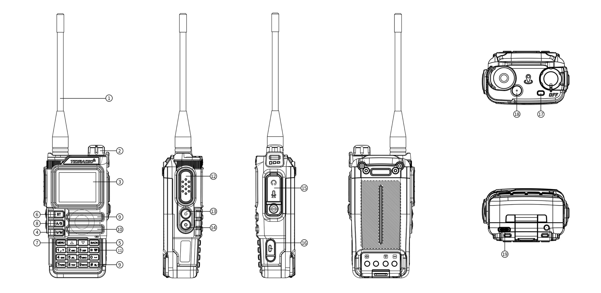

### 4.1 Buttons and controls

> The numbers correspond to the numbers in the diagram above.

| # | Description |
|---|---|
|1. |**Antenna.**|
|2. |**Power/Volume Knob**- turn on/off and adjust volume.|
|3. |**LCD screen 1.77".**|
|4. |**VFO/MR**— switching “Channel mode” / “Frequency mode”.|
|5. |**BACK**— back/exit.|
|6. |**Bluetooth key**- long press on/off Bluetooth.|
|7. |**MENU**— short press to enter the menu.|
|8. |**A/B**— switching ranges A/B.|
|9. |**Dynamics.**|
|10. |**Microphone.**|
|11. |**DTMF / Keypad Lock**- long press on/off key lock.|
|12. |**PTT**— Push-to-talk: hold to speak; let go - welcome.|
|13. |**PF1 - Customizable side key 1.**:|
|--- | - Short press: MENU → Radio Setting → item 27 (options: NONE, FM Radio, Lamp, TONE, Alarm, Weather, PTT2, OD PTT).|
|--- | - Long press: MENU → Radio Setting → item 28 (NONE, FM Radio, Lamp, Cancel Sq, TONE, Alarm, Weather).|
|14. |**PF2 - Customizable side key 2.**:|
|--- | - Short press: MENU → Radio Setting → item 29.|
|--- | - Long press: MENU → Radio Setting → item 30.|
|15. |**MIC/SP connector**— external headset.|
|16. |**USB-C port**— programming.|
|17. |**Indicator:**&#x72;ed - transmission; green - welcome.|
|18. |**Orange Weather key**— entering NOAA weather mode.|
|19. |**USB-C charging port**on battery.|

### 4.2 LCD display. Badges

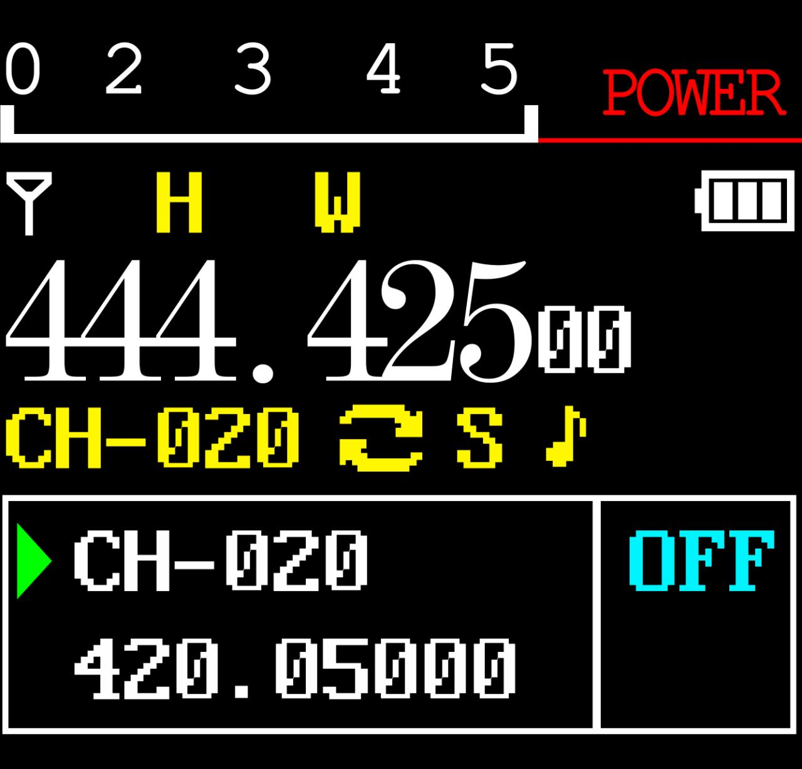

Icons in table order from the manual:
| # | Symbol | Description |
|---|---|---|
|1. ||Signal strength indicator (4 levels).|
|2. ||High transmission power/low transmission power.|
|3. ||Voice/key sound (not shown if both are off).|
|4. ||Current tone: DCS orCTCSS.|
|5. ||Offset “up” (TX above RX) - access to the repeater in VFO mode.|
|6. ||Offset "down" (TX below RX).|
|7. ||Dual watch enabled.|
|8. ||Keyboard locked; holdto unlock.|
|9. |\[S] |Energy saving enabled.|
|10. |\[N] |Channel in narrowband mode.|
|11. |\[W] |Channel in broadband mode.|
|12. ||Battery charge level; when dischargingicon frame blinks(transfer is not possible).|
|13. ||OD transfer icon.|
|14. ||OD move icon.|
|15. ||Bluetooth is on, not connected (white icon).|
|16. ||Bluetooth is connected (blue icon).|
|17. ||Volume indicator.|

### 4.3 LED indicators

| Color | Indicator | Walkie-talkie status |
|---|---|---|
| 🔴 | Permanently red | Transfer |
| 🟢 | Permanently green | Reception |

### 4.4 Basic control keys

| Key | Description |
|---|---|
|**BT**| long press: turn Bluetooth on/off.|
|**MENU**| entering the menu, selecting an item, confirming a parameter.|
|**▲**| press: step up channel/frequency; hold for more than 2 s: quickly move up; in scan mode: move scan up.|
|**▼**| press: step down channel/frequency; hold for more than 2 s: quickly move down; in scan mode: move scan down.|
|**VFO/MR**|  switching between frequency (VFO) and channel (MR) modes. Saving frequencies to memory is only possible in VFO mode.|
|**BACK**| exit menus and functions.|
|**A/B**| switching between upper (A) and lower (B) display; the selected one becomes active for reception and transmission. Memory storage works from display A.|
|**Numeric keypad**| entering information/elections; when transmitting, the numeric keys send the corresponding DTMF codes.|
|**# (DTMF/lock)**| short press: activate DTMF dialing; hold more than 2 s: lock/unlock the keyboard.|

### 4.5 Additional key combinations and activations

**Combinations when turning on the power (Power On):**

| Combination | Function |
|---|---|
| PTT + \* + Enable | Mode switching: GMRS / HAM / Normal |
| PTT + 1 + Enable | Firmware via K-cable |
| PTT + 3 + Enable | Firmware via USB |
| PTT + 7 + Enable | APRS Update |
| PF2 + Enable | Wireless Copy (Mode of copying data over the air between similar radios) |

**Standby keys:**

| Action | Function |
|---|---|
| Hold 0 | Weather |
| Hold 1 | Frequency detector (counter) |
| Hold 3 | Scanner |
| Hold 5 | On/Off Reverse mode on channels with frequency shift of reception and transmission |
| Hold 7 | Spectrum analyzer |
| Hold 8 | Firmware via USB |
| Hold \* | Keylock |
| Hold # | Changing DTMF group (1..8) |
| Hold Back | Switch between modes: radio/GNSS |

**Quick access from the main menu:**

| Action | Function |
|---|---|
| Menu, 1 | Squelch Level - noise reduction level |
| Menu, 2 | Power - transmission power |
| Menu, 3 | Scan Mode - scan mode |
| Menu, 4 | Freq Step - frequency setting step |
| Menu, 5 | Backlight - setting the display backlight |
| Menu, 6 | Voice prompt - voice confirmation of commands |
| Menu, 7 | VOX |
| Menu, 8 | Broadcast Radio - FM radio stations |
| Menu, 9 | Dual Watch (TDR) - dual listening mode |
| Menu, 0 | Bandwidth - bandwidth |

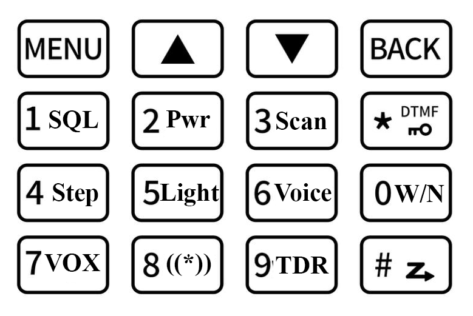     

**Headset mode (Bluetooth calls):**

| Action | Function |
|---|---|
| 1 | Answering a phone call |
| Hold 4 | Call back |
| 3/PTT | Hang up |

**Speaker mode (Bluetooth audio):**

| Action | Function |
|---|---|
| 1 | Previous music track |
| 2 | Play/pause |
| 3 | Next music track |

### 4.6 Numeric keypad

Use these keys to enter information or select radio station settings.\
In transmit (TX) mode, press the number keys to send the corresponding DTMF code.\ 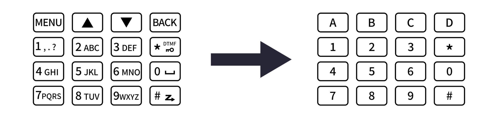

Clickto activate the tone dialing function (DTMF).\
Press and holdmore than 2 seconds allows you to lock or unlock the keyboard.

## 5. Basic Operations

### 5.1 Switching on

Turn the power/volume knob clockwise until you hear a click. After ~1 sec, double beep, message/screen saver display, then frequency or channel. When voice prompts are turned on, the mode will be announced. Turn off - counterclockwise until you hear a click.

### 5.2 Volume

Turn the knob clockwise/counterclockwise.

### 5.3 Channel selection

Two modes:**VFO (frequency)**— for experimentation and quick programming “in the field”;**MR (channel)**- for everyday use of pre-programmed channels. Switching with ▲/▼ keys or encoder.

### 5.4 Challenge

* **Channel mode:**&#x73;elect a channel, hold \[PTT] and speak (red indicator). Reception - automatically when PTT is released (green indicator).
* **Frequency mode:**&#x70;ress \[V/M], enter frequency (within range), hold \[PTT].
* Hold the microphone 2.5–5 cm away from your mouth.

### 5.5 Frequency mode (VFO)

Move by frequency using the ▲/▼ keys (in steps specified in the settings) or directly enter the frequency from the numeric keypad with an accuracy of kilohertz.

Example: Entering frequency 432.56250 MHz on display A:

1. In standby mode, switch to frequency mode (VFO).
2. Enter on the keyboard: \[4] \[3] \[2] \[5] \[6] \[2] \[5] \[0].

> In VFO mode, the VFO icon is displayed. Transmission on prohibited frequencies is illegal; Listening is usually allowed. Check with your local regulator for requirements.

### 5.6 Channel mode (MR)

Depends on the programmed channels. Navigation - using the ▲/▼ keys or the encoder. In MR mode, channel number CH-XXX is displayed.

***

## 6. Additional features

### 6.1 Frequency scanning

1. In frequency mode, hold down the ke&#x79;**\[3 SCAN]**&#x6D;ore than 2 seconds - scanning will begin with the specified step.
2. Stop - ke&#x79;**\[V/M]**.
3. Settings: MENU → Scan → No.1.

### 6.2 Channel scanning

1. In channel mode, hol&#x64;**\[3 SCAN]**&#x6D;ore than 2 seconds.
2. Direction: ▲/▼ keys.
3. Stop -**\[V/M]**.

### 6.3 CTCSS/DCS scanning

In standby mode: MENU → Scan → “SEEK DCS” - select CTCSS or DCS scan. The function is not available in channel mode; scanning will begin only when a signal is detected.

### 6.4 Programming channels manually

199 memory channels, each storing: receive frequency, group signal (tones), channel width, ANI/PTT-ID, six-character channel name. Saving: MENU → Program Channel → item 12 (Memory CHL).

**Modes:**&#x56;FO - frequency; MR - channels. To save, switch to VFO using the VFO/MR key.

**Example 1: Channel 31 with CTCSS tone 123.0 Hz (RX 432.55000 MHz):**

1. Press \[VFO/MR] — VFO mode.
2. \[Menu] → Program Channel → \[1] \[3] \[Menu] - delete previous channel data (for example, 31) → OK.
3. \[Back] → \[2] \[Menu] → ALTER → CTCSS → 123.0 \[Menu] \[Back] - select TX tone.
4. Enter the RX frequency (43255000).
5. \[Menu] → Program Channel → \[1] \[2] - enter the channel number (31) → \[Back] - RX added.
6. Press \[VFO/MR] — return to MR mode.

**Example 2. Frequency search by scanning (recording channel 31):**

1. Press \[V/M] - MR mode (CH-XXX icon).
2. Hol&#x64;**\[3 SCAN]**— scanning.
3. When there is activity on 432.55000 MHz, press \[PTT] - stop.

### 6.5 Emergency Alert

Assign the Alarm function to the side \[PF1] or \[PF2] key in advance, then press this key - the radio will emit a loud signal and the flashlight will blink. Exit - press \[PTT].**ATTENTION:**&#x55;se only in a real emergency.

### 6.6 FM radio

> When you turn on the FM radio listening mode, the bluetooth module is disabled.

Assign \[PF1]/\[PF2] to the FM Radio function in advance. Range 87–108 MHz.

1. Press \[PF1]/\[PF2] - turn on the radio (or Menu, then 8).
2. Select the frequency using the ▲/▼ keys or enter.
3. Press again to exit.

Note: when the signal is lost, the radio automatically returns to FM mode; When making a call, it switches to receive mode (configurable through the menu - FM Interrupt).

### 6.7 NOAA weather

11 NOAA channels. Key: orange**Weather**.

1. Press the orange key to enter NOAA mode.
2. Channel selection - ▲/▼.
3. Press again to exit.

Channels: Wx-01…Wx-11 (162.5500; 162.400; 162.475; 162.425; 162.450; 162.500; 162.525; 161.650; 161.775; 161.750; 162.000 MHz). Reception only, transmission not possible.

### 6.8 Repeater Tone (1000 / 1450 / 1750 / 2100 Hz)

Assign the TONE function to \[PF1]/\[PF2] in advance, select the tone frequency in item 24 Radio Setting. Press \[PF1]/\[PF2] and the repeater tone will be sent. Works even when the keyboard is locked.

### 6.9 Call function (Bluetooth calls)

1. Turn on Bluetooth: MENU → Bluetooth → BT ON/OFF (or long press MENU).
2. Connect your phone (Name: MENU → Bluetooth → BT Name - TD-H9xxxx).
3. Incoming call - short key press**1**- answer.
4. In standby mode, long press the key**4**- call back.
5. During a call, short press**3**or**PTT**- complete.

### 6.10 “Audio” function (music via walkie-talkie)

1. Turn on Bluetooth, connect your phone.
2. A key**1**— previous track;**3**— next track;**2**- long/short press - pause/play.

### 6.11 OD PTT (Unmaster PTT)

1. Turn on Bluetooth (MENU → Bluetooth → BT ON/OFF or long press \[MENU]).
2. Connect your phone.
3. Once connected, the PF1 side key automatically becomes OD PTT and will return to its previous function when disconnected.
4. Make sure the mode is “Receiver” (MENU → Bluetooth → BT Mode).
5. Set OD PTT: OD (OD only) or OD+Analog (OD and simultaneously similar radios on the same frequency).
6. Open the Odmaster application, enter the group.
7. Press OD PTT to talk.

**Step-by-step illustrations of OD PTT setup and operation (manual pages):**

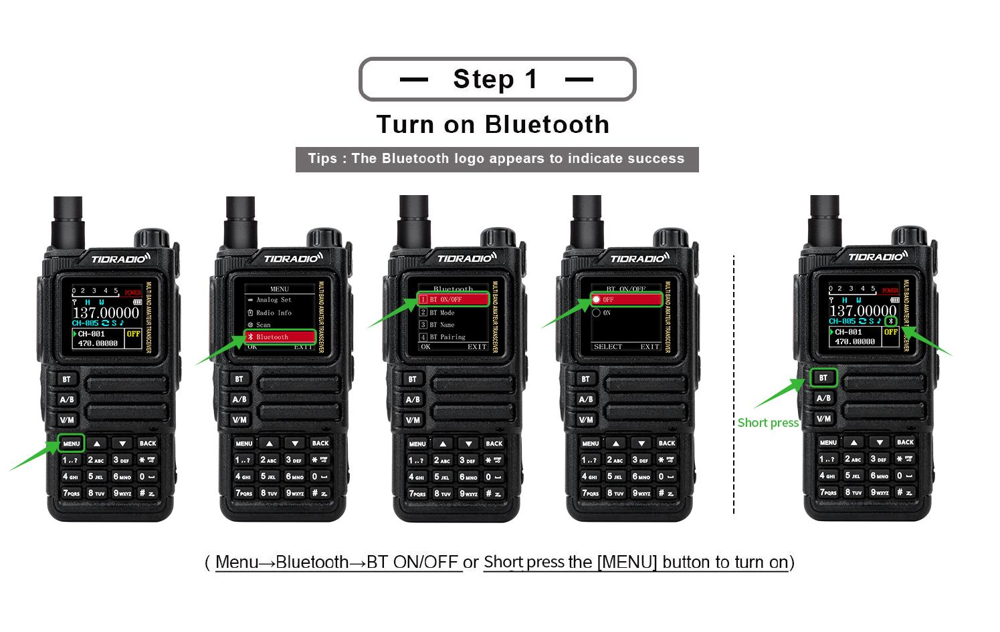
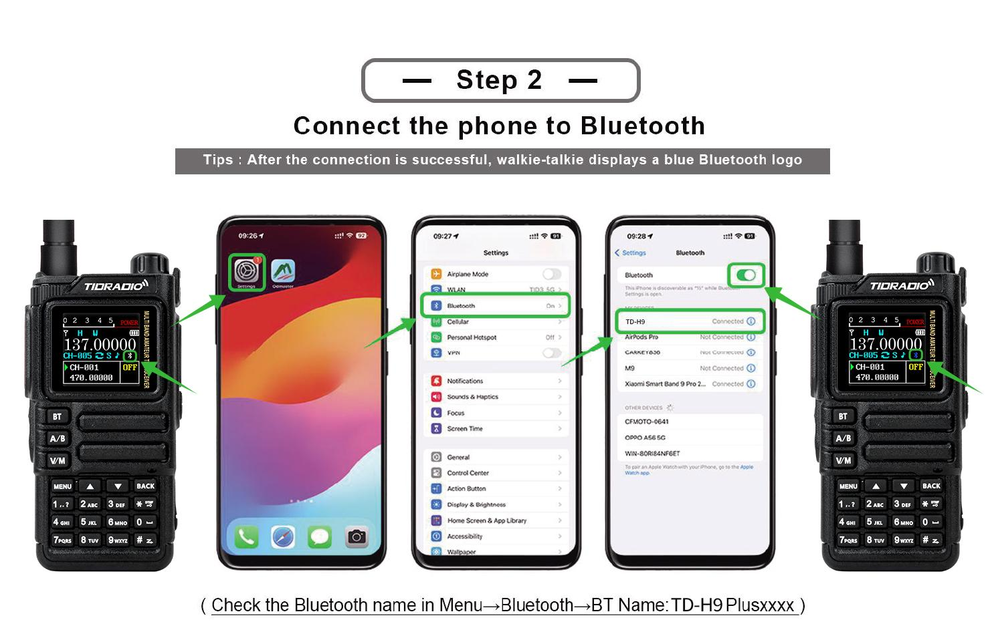
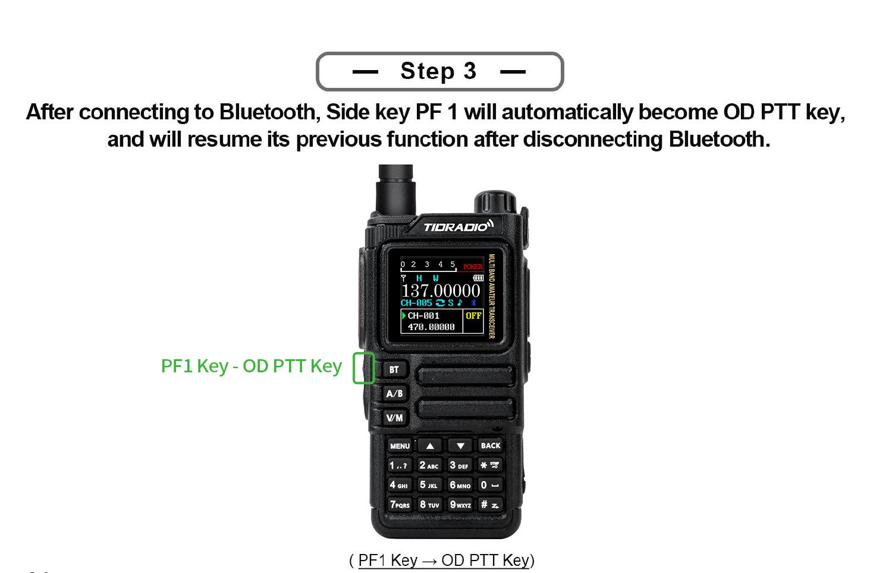
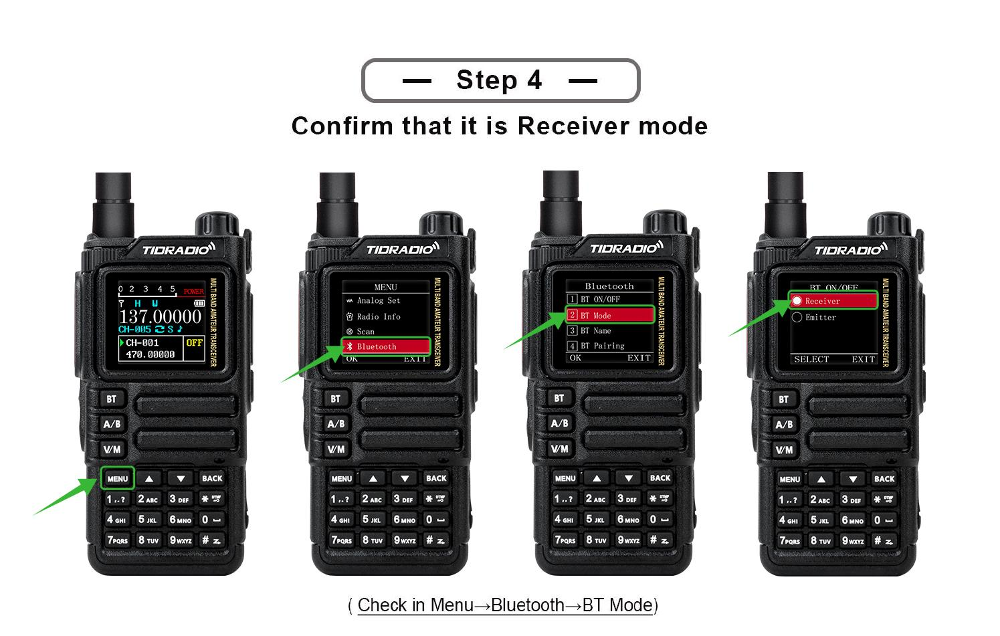
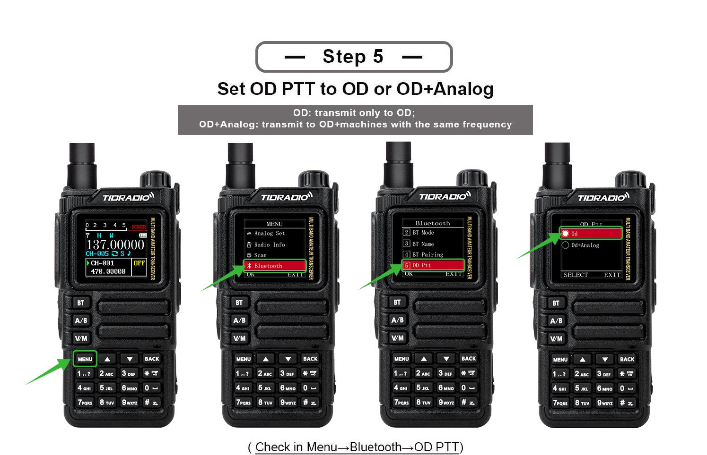
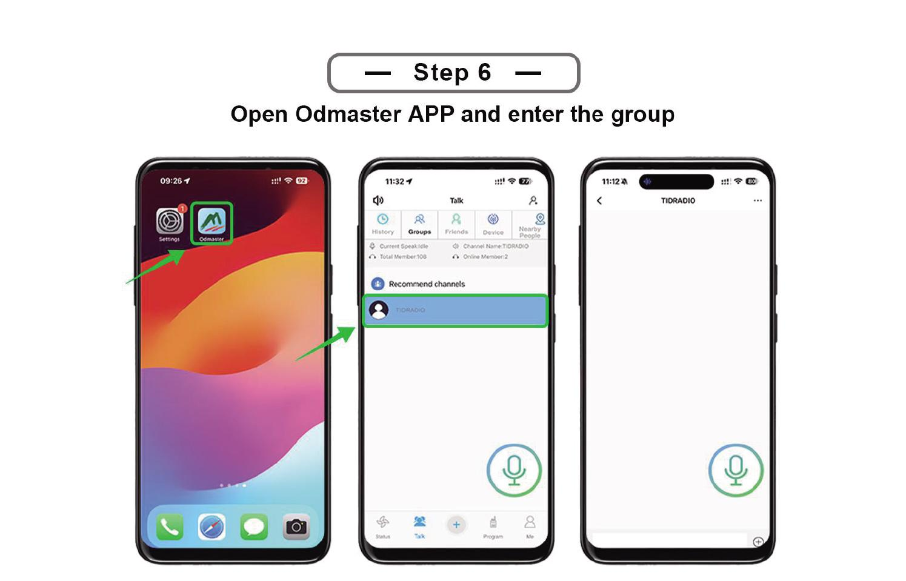
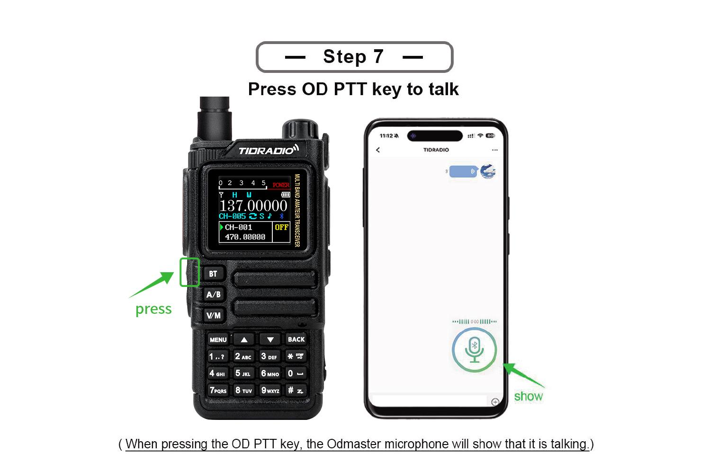

### 6.12 Programming via Bluetooth

(Section with step-by-step illustrations; see the original manual - programming the radio via a Bluetooth connection to the software.) Connect the radio via Bluetooth and use the programming software.

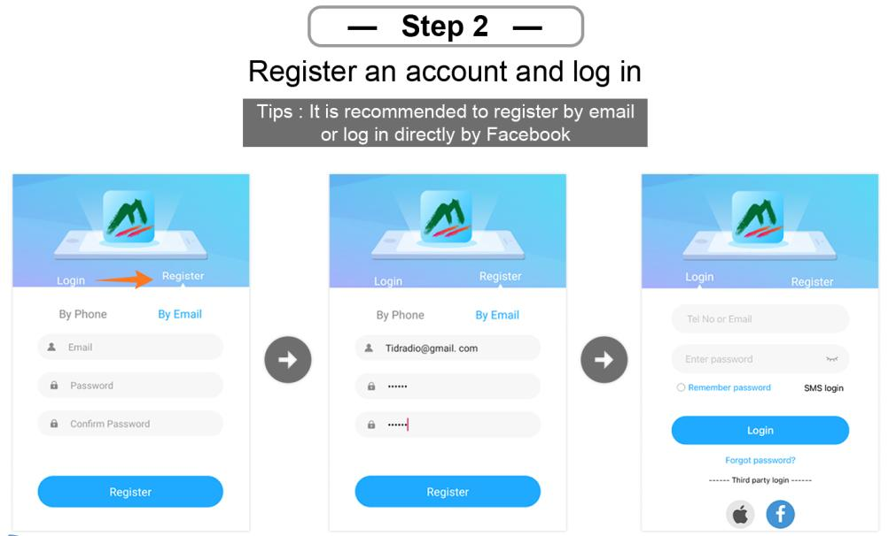
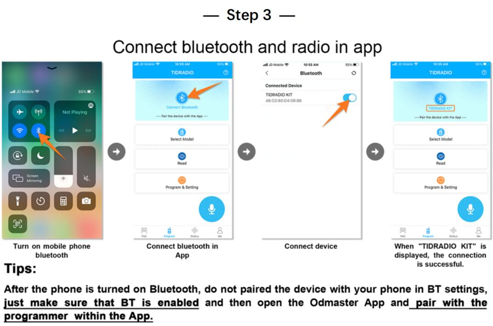
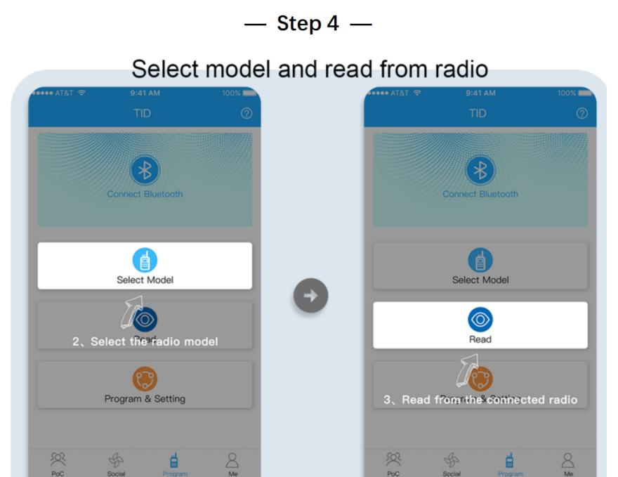

***

## 7. Working with the menu

> In channel mode the following are not available: CTCSS/DCS tones, channel width, PTT-ID, BCL, channel name editing.

### 7.1 Basic use

1. Press \[MENU] to enter the menu.
2. ▲/▼ — move through items.
3. \[MENU] - select an item.
4. ▲/▼—select a parameter.
5. \[MENU] - confirm and return to the menu; \[BACK] - cancel and exit the menu.
6. \[BACK]—exits the menu at any time.

### 7.2 Short commands (shortcuts)

1. Press \[MENU].
2. Enter the item number using the numeric keypad.
3. \[MENU] - enter the item.
4. Parameter: ▲/▼ or numeric shortcode.
5. \[MENU] - save; \[BACK] - cancel.
6. \[BACK] - exit.

### 7.31 Radio Setting

| No. | Function | Description |
|---|---|---|
| 1 | Squelch LV | Squelch level 1–9 (1 is the lowest, 9 is the highest). Default is 4. |
| 2 | Step Frequency | Frequency step: 0.5/2.5/5.0/6.25/10.0/12.5/25.0/50.0 kHz. Does not change in channel mode. |
| 3 | VOX Level | Voice activation level: Off, 1–5. |
| 4 | VOX Delay | VOX delay: 1.0/2.0/3.0s. |
| 5 | TOT | Transmission limit timer: off/30/60/90/120/150/180/210s. |
| 6 | Roger Beep | Beep when PTT is released. |
| 7 | Beep | The sound of the keys. |
| 8 | Power Save | Energy saving: Off, 1:1 / 1:2 / 1:3 / 1:4 (work : sleep). |
| 9 | Keypad Lock | Automatic keypad lock |
| 10 | Dual Watch | Dual Listening Mode (TDR) A and B |
| 11 | Voice | Voice confirmation of commands |
| 12 | Backlight | Screen backlight timeout |
| 13 | Brightness | Screen brightness (Recommended setting: 5, with other values ​​a squeak is transmitted during transmission and the screen is on) |
| 14 | Pwr On Disp | Welcome screen when turned on (Voltage/Message/Picture) |
| 15 | Display | Radio station mode display mode - Single (single channel), Dual and Classic (two channel)
| 16 | ANI-Edit | DTMF radio station ID |
| 17 | Disp Type-A | Displaying information about programmed channel A (Freq + Number / Name + Number) |
| 18 | Disp Type-B | Displaying information about programmed channel B (Freq + Number / Name + Number) |
| 19 | DTMF DISE | DTMF signals during transmission: OFF/ON. |
| 20 | PTT Delay | PTT Release Delay |
| 21 | Language | English / Chinese. |
| 22 | Alarm Mode | On Site (local signal only, flashlight flashing) / TX Alarm (10 sec sound, 2 sec pause, cycle). |
| 23 | Side Tone (Tail) | Tail suppression: ON/OFF (method is set by CPS). |
| 24 | Tone Burst (TBST) | Repeater tone: 1000/1450/1750/2100 Hz. Send using the side key (TONE). |
| 25 | Talk Around | OFF: outside the repeater coverage - “failed to activate relay”; ON: TX = RX, on the screen “|→|”. |
| 26 | FM Interrupt | OFF: in FM mode the call does not interrupt; ON: When there is a call, FM is interrupted for 5 seconds. |
| 27 | PF1 S Press | Short press PF1: NONE, FM Radio, Lamp, TONE, Alarm, Weather, PTT2, OD PTT. |
| 28 | PF1 L Press | Long press PF1: NONE, FM Radio, Lamp, Cancel Sq, TONE, Alarm, Weather. |
| 29 | PF2 S Press | Short press PF2: similar to step 27. |
| 30 | PF2 L Press | Long press PF2: similar to step 28. |
| 31 | Top S Press | Short press of the top button: similar to step 27. |
| 32 | Top L Press | Long press the top button: similar to step 28. |
| 33 | Factory R | Reset: VFO (frequency settings only), CHL (channels only), FULL (all). |
| 34 | Breath Led | LED flashing frequency in standby mode. |
| 35 | MIC GAIN | Microphone Gain: 0–9. |
| 36 | DTMF Speed ​​| DTMF speed (default 110ms). |
| 37 | DCD | OFF: DTMF alarm disabled. ON: Enable DTMF call/group call. |
| 38 | D-HOLD | DTMF auto reset time: 5–60 sec. |
| 39 | D-RSP | DTMF response: NULL / RING / REPLY / BOTH. |
| 40 | 200TX | ON: Open 220-260 MHz band in VFO mode. |
| 41 | 350TX | ON: Open 350-390 MHz band in VFO mode. |
| 42 | 500TX | ON: Open high UHF (up to 520 MHz) in VFO mode. |
| 43 | Menu Color | The color of the current menu item. |

### 7.32 Program Channel

| No. | Function | Description |
|---|---|---|
| 1 | RX Sub-audio | Receive tone: CTCSS (67.0–254.1), DCS (D023N–D754N), Reverse DCS (D023I–D754I). |
| 2 | TX Sub-audio | Transmission tone: similar. |
| 3 | Bandwidth | Wide (25 kHz) / Narrow (12.5 kHz). |
| 4 | TX Power | Low/Middle/High. |
| 5 | Busy Lock | BCL: OFF - transmission is allowed when the channel is busy; ON - prohibited. |
| 6 | Call Code | 8 groups of alarm codes (editable from PC). |
| 7 | PTT-ID | Send ANI-ID: OFF / BOT (when PTT is pressed) / EOT (when released) / BOTH. |
| 8 | ScanAdd | ON—the channel is involved in scanning; OFF - does not participate. |
| 9 | Scramble | Voice scrambling (same for both). |
| 10 | OFFSET | TX/RX offset: 0.000–99.998 MHz. |
| 11 | SET-D | Offset direction: OFF / Positive / Negative. |
| 12 | Memory CHL | Saving the channel (save the specified parameters before recording). |
| 13 | Delete CHL | Deleting a channel. |
| 14 | Hopping | Frequency hopping: ON/OFF (group interference protection). |
| 15 | CH-Name | Channel name |
| 16 | Modulation | Modulation (AM/FM) |

### 7.33 Analog Set

| No. | Function | Description |
|---|---|---|
| 1 | Frequency Calibration | Calibration: UHF / VHF range. |
| 2 | AM Volume Level | AM volume level: 1–5. |

### 7.34 Radio Information

| No. | Function |
|---|---|
| 1 | Version Info | Radio ID, Radio Alias, firmware version, hardware version. |
| 2 | APRS Info | APRS Call, APRS firmware version, APRS hardware version. |
| 3 | User Manual | ... |

### 7.35 Scan

| No. | Function | Description |
|---|---|---|
| 1 | Scan Mode | TO / (CO) / SE (default CO). |
| 2 | SEEK DCS | Frequency scanning with DCS/CTCSS/R-DCS. Not available in channel mode. |
| 3 | Hang Time | Signal detection hold time: 0.5s increments, default 1s. |
| 4 | Scan Frequency | Quick search for frequency with one touch: 1) long press of key 1 - enter; 2) ▲/▼ — select a channel to save; 3) on the screen the frequency and DCS during transmission; 4) wait for completion; 5) \[Menu] - confirm/save, \* key - retake. |
| 5 | Freq Ranger | Scanning frequency range |
| 6 | Spectrum | Spectrum analyzer |

### 7.36 Bluetooth

> In mode**Receiver**The walkie-talkie can act as a Bluetooth speaker for playing sound/music.\
> In mode**Emitter**The walkie-talkie connects to external devices: headsets, microphones, PTT.

| No. | Function | Description |
|---|---|---|
| 1 | BT ON/OFF | Turn Bluetooth on/off. |
| 2 | BT Mode | Receiver (walkie-talkie - receiver, connects to the phone; name TD-H9 XXXX, do not connect to the BLE suffix) / Emitter (walkie-talkie - source; pairing through step 4). Compatible Accessories: Bluetooth PTT, MIC, Headset. |
| 3 | BT Name | Name: TD-H9xxxx. |
| 4 | BT Pairing | Pairable (search for devices: PTT, MIC, headset) / Paired (list of paired ones: PTT, MIC, headset). |
| 5 | OD PTT | OD (Odmaster only) / OD + Analog (simultaneous with analog transmission). |
| 6 | OD Mode | Local Mode (sound via walkie-talkie; default) / Forward Mode (forwarding to other walkie-talkies/platforms) / Full Mode (both). |
| 7 | BT Int MIC | Bluetooth microphone gain switch: OFF/ON. |
| 8 | BT Int Spk | Bluetooth speaker gain switch: OFF/ON. |
| 9 | BT MIC Gain | BT microphone gain: 1–5. |
| 10 | BT Spk Gain | BT speaker gain: 1–5. |
| 11 | BT Pin Code | Pairing PIN: 0000 / 000000 / 123456. |
| 12 | BT Reset | ... |

#### Bluetooth Features

The radio can only maintain one Bluetooth connection at a time. To interact with a smartphone or PC, you must select BT Mode: Receiver. To connect a headset - BT Mode - Emitter.

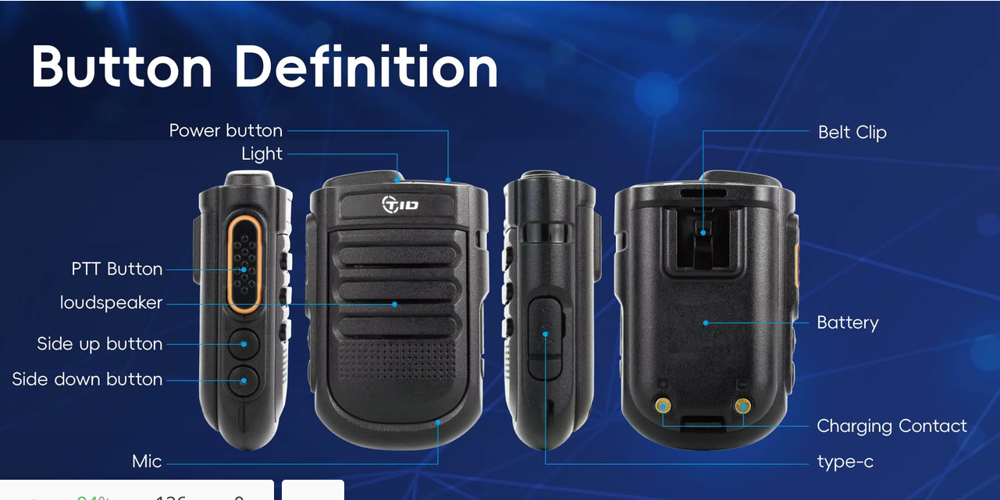  

When working with[**TIME MIC**](https://tidradio.com/products/tidradio-handheld-wireless-microphone-with-bluetooth)there is a significant delay in order*1~2.5*seconds when pressing the PTT switch to gear and about*1~1.5*seconds when receiving a signal. When you press the PTT button, the Bluetooth audio channel first opens, only after that the radio frequency path opens for transmission and the red indicator lights up. This should be taken into account.

    

When working with[**TIME-PTT**](https://tidradio.com/products/tidradio-wireless-ptt-button)the delay is significantly lower than with**TIME MIC**and amounts to*0.2~1*seconds, i.e. The radio opens to transmit faster. When connecting TID-PTT to a smartphone**ODmaster**works with the device**TID-PTTxxxxxx-A**(speed*38400*baud), when pairing via the Android Bluetooth menu, it is not recommended to pair with this device -**ODMaster**may not see him. Instead there is a device**TID-PTTxxxxxx-B**.

### 7.37 Firmware update

1. Login:[web.odmaster.net](https://web.odmaster.net/).
2. Remote Control Program → Upgrade Firmware.
3. Follow the steps on the screen.

Or

1. Open[Firmware](Firmware)
2. Download drivers and the latest firmware version
3. Follow the instructions in the archive

> Important: updating the APRS firmware erases all settings. Call sign, APRS configuration, channel frequencies, digipeater paths - everything disappears!

There are two ways to connect the radio to your computer for programming and firmware updates. The first is a USB-C data port on the side of the case, next to the K-1 PTT connectors. The second is the CH340 programming cable, which connects to the same K-1 connectors and connects to the computer via USB-A.

### 7.38 GNSS (GPS)

| No. | Function | Description |
|---|---|---|
| 1 | GPS ON/OFF | On/off GPS. |
| 2 | GPS Information | Antenna, longitude, latitude, date, time, altitude, course, speed, satellites. |
| 3 | Position | Coordinate format: (D) / DM / DMS - Deg, Deg.min, Deg.min.s. |
| 4 | Time Zone | Time zone UTC-12…UTC+12 (default +3). |
| 5 | Speed ​​Unit | Speed ​​units: (Kmph) / Knot / Mpt. |
| 6 | Distance Unit | Distance units: (Km) / Sea / Mile. |
| 7 | Altitude Unit | Height units: (M) / Ft. |
| 8 | Fixed Latitude | Fixed latitude (example 44° 35' 04" - ▲/▼ selection, \[#] confirmation). |
| 9 | Fixed Longitude | Fixed longitude (example 40° 06' 38"). |
| 10 | Fixed Altitude | Fixed height (default 0). |

### 7.39 Site Type

* **Fix Coordinates**— fixed coordinates.
* **GPS Coordinates**— GPS coordinates.

Fixed coordinates are transmitted if the beacon transmission mode via APRS is activated, if the corresponding setting is enabled.
GPS coordinates - when it was possible to determine the location.

If the radio station is stationary, you can turn off GPS and the station will send the coordinates specified by the settings (menu items 7.38.8 Fixed Latitude, 7.38.9 Fixed Longitude and 7.38.10 Fixed Altitude).

### 7.40 APRS

> When working with APRS, it is advisable to completely disable the power saving mode so as not to miss the beginning of the packet.

| No. | Function | Description |
|---|---|---|
| 1 | APRS Switch | APRS on/off. |
| 2 | Beacon Set | Beacon setup: |
| 2.1 | .. |**Call Sign**- amateur radio call sign (up to 6 characters, capital Latin + numbers; ▲/▼ character selection, confirm - enter, back - delete, # - save)|
| 2.2 | .. |[**SSID**](http://aprs.ru/index.php/SSID)(0–15, default 11)|
| 2.3 | .. |[**SSID Symbol**](https://www.aprs.org/symbols.html)(`/`or`\`) according to[table](Customer%20Programming%20Software/Disasm/APRS_symbols.md)|
| 2.4 | .. |**Custom Information**- commentary to the APRS package, up to 60 English ASCII characters |
| 2.5 | .. |[**Icon Settings**](Customer%20Programming%20Software/Disasm/APRS_symbols.md)- the reference book being viewed according to[table](Customer%20Programming%20Software/Disasm/APRS_symbols.md).  Use it to find the symbol you want, then enter the code in the SSID Symbol. |
| 2.6 | .. |**MIC Start**(On/Off)|
| 2.7 | .. |**MIC Type**(MO: Off Duty / M1: En Route / M2: In Service / M3: Returning / M4: Committed / M5: Special / M6: Priority / M7: Emergency)|
| 2.8 | .. |[**Route 1**](Docs/APRS_Digipeater_ru.md): Use the ▲/▼ buttons to select a character. Click the confirm button to select it. If you made a mistake, please click the back button to delete|
| 2.9 | .. |[**Route 1 Count**](Docs/APRS_Digipeater_ru.md): (0–9)|
| 2.10 | .. |[**Route 2**](Docs/APRS_Digipeater_ru.md): Use the ▲/▼ buttons to select a character. Click the confirm button to select it. If you made a mistake, please click the back button to delete|
| 2.11 | .. |[**Route 2 Count**](Docs/APRS_Digipeater_ru.md): (0–9)|
| 2.12 | .. |**Report Voltage**-send battery information (default ON)|
| 2.13 | .. |**Report Sats**-send information about satellites (ON by default) |
| 2.14 | .. |**Report Mileage**-send mileage information (default OFF)|
| 3 | Beacon Type | Setting up beacon transmission: |
| 3.1 | .. |**PTT Linkage**(beacon each time PTT is pressed/released; default is OFF)|
| 3.2 | .. |**Timed Beacon**- send information at a specified frequency (ON by default) |
| 3.3 | .. |**Timing**— interval in seconds, for example 0090 = every 90 s (enter in numbers + \[#]). |
| 4 | Relay Set | APRS repeater mode settings: |
| 4.1 | .. |**DIGI Forward CH**- to which channel to relay packets (A / (B) / AB)|
| 4.2 | .. |**DIGI1 Enable**(default OFF)|
| 4.3 | .. |**DIGI1 Name**(default WIDE1), up to 6 ASCII characters: capital letters and numbers|
| 4.4 | .. |**DIGI2 Enable**(default OFF)|
| 4.5 | .. |**DIGI2 Name**(default WIDE2), up to 6 ASCII characters: capital letters and numbers|
| 4.6 | .. |**Wait Before Forwarding**- delay before retransmission (0–9c). If there are several repeaters, it allows you to spread the transmission time and avoid collisions of beacons on the air |
| 4.7 | .. |**Remote Password**- password for remote control of the repeater via KISS (TNC) (default 123456). |
| 5 | Advanced Set | Advanced reception/transmission settings: |
| 5.1 | .. |**APRS RX CH**- on which channel to receive APRS (OFF / A / (B)) |
| 5.2 | .. |**APRS TX CH**- on which channel to transmit APRS (OFF / A / (B)) |
| 5.3 | .. |**PTT Priority**- priority for simultaneous voice/APRS transmission (Talk / (APRS))|
| - | .. |**RX Decode Tone**- sound signal upon successful reception and decoding of APRS (default ON)|
| - | .. |**TX Tone**- sound signal when transmitting APRS (default OFF) |
| 5.4 | .. |**Beacon Auto Popup**(default ON) - display a screen with information about the received beacon |
| 6 | Beacon List | List of beacons: up to 100 accepted; management/delete. |
| 7 | APRS Reset | Reset APRS to factory settings. |

### 7.41 Detailed Description of APRS Functions

| # | Topic | Description |
|---|---|---|
|1|**Channel APRS**| A/B channels can be assigned to APRS or voice; supported modes: |
|.|..| - receive+transmit on A|
|.|..| - receive A / transmit B (cross-repeater)|
|.|..| - only reception A|
|.|..| - simultaneous transmission of A and B|
|.|..| - receive+transmit on B|
|.|..| - receive B / transmit A (cross-repeater)|
|.|..| - only reception B|
|.|..| Work outside the network is supported (without the Internet and cellular communications) - walkie-talkies determine each other’s positions directly.|
|2|**Bluetooth**| KISS TNC support over Bluetooth; data can be parsed and displayed or uploaded to the web via Odmaster.|
|3|**APRS Relay (DIGI)**| Full DIGI relay with custom names; enable/disable remotely.|
|4|**LITTLE**| Beacons are compressed and transmitted in MIC-E format - shorter on-air time, fewer collisions, higher probability of successful decoding.|
|5|**PTT Delay**| Configurable delay between pressing PTT and the start of transmission (useful when the remote station's squelch is slow).|
|6|**APRS Digital Relay**| Two repeater names: default WIDE1 and WIDE2 (up to 6 characters, numbers or capital letters). Rule: when receiving a valid beacon containing the name of the repeater and a hop counter > 1, the radio transmits the packet once, decreasing the counter by 1. If the counter is 0, the packet is not forwarded. Each transition is a complete cycle of reception → decode → transcoding → transmission. The counter limits infinite spread.[Read more...](http://wa8lmf.net/DigiPaths/)|
|7|**Remote password**| The default**123456**(6 digits).|
|8|**Fixed station**| With the Fix Coordinates type, the given coordinates are used to calculate the distance/bearing.|
|9|**Maps/Track View**| ... |
|.| Odmaster: | - https://web.odmaster.net/login. |
|.| APRS.fi | - https://aprs.fi/ |
|.| APRS.to | - https://aprs.to/ |
|.| APRS Map Info | - https://aprs-map.info/ |

> PTT Linkage and Timed Beacon cannot be enabled at the same time. If both are enabled, Timed Beacon does not work.

> APRS bandwidth must be Wide!

### 7.42 APRS Repeater Remote Control

You can send a control packet from any other radio station or smartphone connected to the transceiver, formatting it as a standard APRS Message addressed to the call sign of your radio station (for example, N0CALL-9). The combination \[password]\[command] is entered in the message text (for example, 123456A1). If the radio station successfully receives and decodes the message, it will change the operating mode of the built-in digipeater.

The password must strictly consist of 6 digits. For the tracker to execute the command, the message must contain your password and then the command itself (without spaces)

Available remote commands:
|Team|What they do|
|---|---|
|A1|Enable repeater 1 (DIGI 1 - activate the digipeater function)|
|A0|Turn off repeater 1 (DIGI 1)|
|B1|Enable repeater 2 (DIGI 2)|
|B0|Turn off repeater 2 (DIGI 2)|
|R0|Reset current settings and reboot the device with parameters from non-volatile EEPROM|

### 7.43 Retransmission of APRS packets by digipeater

[APRS relay](Docs/APRS_Digipeater_ru.md)is the process: reception → decoding → transcoding → sending. Each rebroadcast ensures the best possible signal quality, unlike traditional analog voice relays.

Due to the fact that the beacon contains a specified number of relays, endless relays do not occur.

In digipeater mode, when a radio station receives an APRS packet, it searches its PATH for the name of the installed digipeater, and if it finds it, it forwards this packet further on the air, decrementing the SSID by one, but only if the SSID is greater than zero.

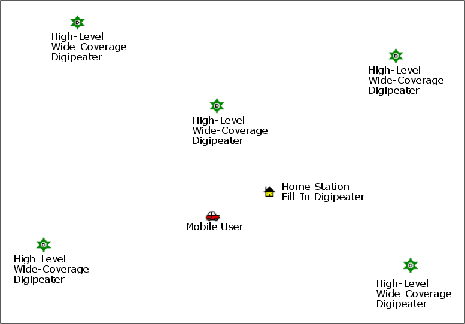

### 7.44 APRS Worldwide Frequencies

| Frequency | Description |
|---|---|
| 144.3900 MHz | North America: United States, Canada, Chile |
| 144.3900 MHz | Indonesia, Singapore, Malaysia |
| 144.3900 MHz | Thailand (https://www.qsl.net/rast/text/2mbandplan.htm)
| 144.3900 MHz | Mexico, Dominican Republic, Puerto Rico, Trinidad & Tobago, Columbia |
| 144.8000 MHz | Europe, UK, Ireland, Iceland,**Russia**|
| 144.8000 MHz  | South Africa, Azores, Costa Rica, Israel, Lebanon, Senegal |
| 145.1750 MHz  | Australia, Tasmania |
| 144.5750 MHz  | New Zealand  |
| 144.9300 MHz  | Argentina, Uruguay, Paraguay  |
| 144.6600 MHz  | Japan  |
| 144.6400 MHz  | China, Hong Kong, Taiwan  |
| 144.6200 MHz  | South Korea  |
| 145.5250 MHz  | Thailand (OLD)  |
| 145.5700 MHz  | Brazil  |
| 433.8000 MHz  | Europe (Primary)  |
| 432.5000 MHz  | Europe (Secondary)  |
| 439.1000 MHz  | Australia  |
| 430.5125 MHz  | Netherlands  |
| 432.5750 MHz  | New Zealand  |

> Do not use the above frequencies for voice transmission!

http://aprs.qrz.ru/freq.php\
https://www.sigidwiki.com/wiki/Automatic\_Packet\_Reporting\_System\_(APRS)\
https://aprs.fi/

### 7.45 APRS radio with similar functionality

**Significant disadvantages of implementing APRS on H9**:

* Inability to assign a beacon to be sent by pressing the side key (Send Beacon)
* Inability to mute sound on APRS channel (Mute A/B)
* Inability to work with APRSDroid, only ODMaster

APRS radio station similar in functionality -**Lanchonlh HG-UV98**:

* [HG-UV98](https://github.com/dkxce/HG-UV98)
* [lanchonlh\_hg-uv98\_ru\_manual](https://github.com/dkxce/lanchonlh_hg-uv98_ru_manual)

> The HG-UV98 has better band pass filters (BPF) than the H9. The H9 has better APRS signal selectivity.

> For correct interaction with**Lanchonlh HG-UV98**needs to be configured**APRS RX Level**of UV98.

### 7.46 SMS

> When working with SMS, it is necessary to disable the Dual Watch (TDR) mode and it is advisable to remove the power saving mode

The radio station allows you to send and transmit short messages between similar stations:**TD-H9**и TD-H3+.\
Or send and receive messages via APRS.

> In RF operating mode, messaging is only possible between**TD-H9**and TD-H3+. The recipient is indicated by the Radio ID of the radio station (Radio Info -> Radio ID).
> Radio ID is configured via CPS on the computer (DTMF Code -> DTMF Settings -> Local ID).

> In APRS operating mode, messages are exchanged using APRS Message (:) packets. The recipient and sender are displayed correctly on the pop-up screen.
> On the incoming SMS viewing screen, the sender is indicated as the recipient.
>
> 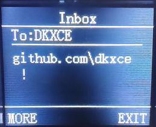

| Item | Name | Description |
|---|---|---|
| 1 | SMS ON/OFF | On/Off SMS reception mode |
| 2 | Send SMS | Sending a message to the recipient. The recipient of the message is an amateur radio call sign with the SSID suffix. |
| 3 | Inbox | Inbox |
| 4 | Outbox | Outgoing messages |
| 5 | Draft | Message Templates |
| 6 | SMS Mode | SMS mode (RF /[APRS](https://www.aprs.org/aprs-messaging.html)) |
| 7 | RX Filter | Message Reception Filter |
| 8 | Statistics | Message Statistics (Memory Usage) |

### 7.47 Spectrum

The radio allows you to view the radio frequency spectrum.\ 

| Management | Description |
|---|---|
| Hold 7 | Entering spectrum analyzer mode |
| MENU | Entering the spectrometer settings text menu |
| BACK/EXIT | Quick exit from spectrum analyzer mode |
| PF1 | Excluding frequency from scanning (You may need to re-enter spectrum mode, or reset peak values**0**) |
| PF2 | Including Frequency in Scan |
| # | Automatic transition of the cursor to the peak of the strongest signal |
| 2/8 (hold) | Changing the RSSI threshold (Threshold) |
| ▲/▼ | Frequency navigation (cursor movement) |
| \* | Cursor On/Off |
| PTT | Monitor Mode (MONI) - Instantly opens the squelch to listen to the frequency under the cursor |
| 0–9 | Manual input of center frequency |

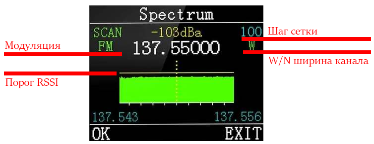    

**Menu**:

| Item | Name | Description |
|---|---|---|
| 1 | Modulation | Modulation change |
| 2 | Step Frequency | Changing the scanning frequency grid step 0.1/0.5/1.0/2.5/5.0/6.25/10.0/12.5/25.0/50/100 kHz |
| 3 | Threshold | RSSI Threshold (minimum signal strength level in decibels (dBm) |
| 4 | Cursor | Cursor On/Off |
| 5 | Bandwidth | Setting Channel Width (W/N) |
| 6 | Reset | Resetting the spectrometer and clearing cut frequencies |

### 7.48 Morse

The radio can transmit and receive Morse code. Adjustable TX speed, RX threshold and tone frequency.

| Item | Name | Description |
|---|---|---|
| 1 | Morse On/Off | Morse mode |
| 2 | Key TX | Manual transfer mode |
| 3 | Edit TX | Entering transmission text with sending |
| 4 | RX Code | Morse code reception mode |
| 5 | TX Speed ​​| Baud rate for automatic mode 5/8/12/18 |
| 6 | RX Threshold | RSSI Threshold (minimum signal strength level in decibels (dBm)) |

> When transmitting Morse code, CTCSS or DCS subtones are not transmitted.

***

## Appendix A: Troubleshooting

| Problem | Analysis | Solution |
|---|---|---|
| Doesn't turn on | Battery installed incorrectly / discharged / poor contact | Reinstall the battery; charge or replace; clean contacts |
| Weak/shaky voice when receiving | Low volume / antenna loose or incorrectly installed / speaker clogged | Increase volume; turn off and reinstall the antenna; clean the speaker |
| No connection with group | Frequency or signals do not match/too far away | Check frequencies and signals; get closer |
| Other people's voices/noise are heard | Frequency interference / no signaling in analogue mode | Change the frequency or raise the squelch; set up alarm |
| Can't hear anyone (noise) | Large Obstacles/Open Area/Electromagnetic Interference | Go to an open, flat area, restart the radio; move away from sources of interference |
| Constant transmission | VOX is turned on or the headset is not inserted all the way | Turn off VOX; check headset |

## Appendix B: Specifications

| Parameter | Meaning |
|---|---|
| Frequency Range (Amateur, RX & TX) | 136–173.99 and 400–519.99 MHz (TX/RX also 174–245, 240–260, 290–350, 350–400, 470–520, 520–600 MHz; RX 50–76, 65–108 (FM radio), 108–136 (AM/FM air), 220–260, 350–390 MHz) |
| Memory channels | 199 |
| RF Power Output | up to 10 W (3 levels: high, medium, low) |
| Operating voltage | DC 7.4 V ±10% |
| Battery capacity | 2400 mAh (Li-Ion) |
| Frequency stability | ±2.5 ppm |
| Operating temperature | -20°C to +50°C |
| Operating hours | Simplex |
| Antenna impedance | 50 Ohm |
| Antenna connector | On the SMA-Male radio, on the SMA-Female antenna |
| Headset jack | K-Plug (Kenwood 2-pin) |
| Display | 1.77" color LCD, 3 display modes, 18 menu colors |
| GPS | Built-in GPS/GNSS |
| Bluetooth | Built-in (for configuration via Odmaster, headsets) |
| APRS | Built-in support (KISS TNC, DIGI, MIC-E) |
| Spectrum analyzer | Built-in |
| CPU/RAM/Flash | 240 MHz / 120 MB / 16 MB |
| Radiochip / MK | Beken BK4819/PY32F003 |
| FM Modulation |[11K0F3E](Docs/emission-types-radionerds-ru.md)@ 12.5 kHz (Narrow band) /[16K0F3E](Docs/emission-types-radionerds-ru.md)@ 25 kHz (Wide band) |
| Adjacent Channel Power | 60 dB @ 12.5 kHz |
| Transfer current | ≤ 1500 mA |
| Receiver sensitivity | 0.25 µV (12 dB SINAD) |
| Adjacent channel selectivity | ≥ 55 dB @ 12.5 kHz |
| Intermodulation Suppression | ≥ 55 dB @ 12.5 kHz |
| Stray radiation | ≤ -57 dB @ 12.5 kHz |
| Sound output power | 1 W @ 16 Ohms |
| Receive current | ≤ 380 mA |
| Sound distortion | ≤ 5% |
| Dimensions (without antenna) | 140 × 53 × 32 mm |
| Weight | 190 g |

## Appendix C. DCS Code Table

| №| Код | №| Код | №| Код |
|---|---|---|---|---|---|
| 1| D023N | 2| D025N | 3| D026N |
| 4| D031N | 5| D032N | 6| D036N |
| 7| D043N | 8| D047N | 9| D051N |
| 10| D053N | 11| D054N | 12| D065N |
| 13| D071N | 14| D072N | 15| D073N |
| 16| D074N | 17| D114N | 18| D115N |
| 19| D116N | 20| D122N | 21| D125N |
| 22| D131N | 23| D132N | 24| D134N |
| 25| D143N | 26| D145N | 27| D152N |
| 28| D155N | 29| D156N | 30| D162N |
| 31| D165N | 32| D172N | 33| D174N |
| 34| D205N | 35| D212N | 36| D223N |
| 37| D225N | 38| D226N | 39| D243N |
| 40| D244N | 41| D245N | 42| D246N |
| 43| D251N | 44| D252N | 45| D255N |
| 46| D261N | 47| D263N | 48| D265N |
| 49| D266N | 50| D271N | 51| D274N |
| 52| D306N | 53| D311N | 54| D315N |
| 55| D325N | 56| D331N | 57| D332N |
| 58| D343N | 59| D346N | 60| D351N |
| 61| D356N | 62 | D364N | 63| D365N |
| 64| D371N | 65| D411N | 66| D412N |
| 67| D413N | 68 | D423N | 69| D431N |
| 70| D432N | 71| D445N | 72| D446N |
| 73| D452N | 74| D454N | 75| D455N |
| 76| D462N | 77| D464N | 78| D465N |
| 79| D466N | 80| D503N | 81| D506N |
| 82 | D516N | 83| D523N | 84| D526N |
| 85| D532N | 86| D546N | 87| D565N |
| 88| D606N | 89| D612N | 90| D624N |
| 91| D627N | 92| D631N | 93| D632N |
| 94| D645N | 95| D654N | 96| D662N |
| 97| D664N | 98| D703N | 99| D712N |
| 100| D723N | 101| D731N | 102| D732N |
| 103| D734N | 104| D743N | 105| D754N |
| 106| D023I | 107| D025I | 108 | D026I |
| 109 | D031I | 110| D032I | 111| D036I |
| 112| D043I | 113| D047I | 114| D051I |
| 115| D053I | 116| D054I | 117| D065I |
| 118| D071I | 119| D072I | 120| D073I |
| 121| D074I | 122 | D114I | 123| D115I |
| 124| D116I | 125| D122I | 126| D125I |
| 127| D131I | 128| D132I | 129| D134I |
| 130| D143I | 131| D145I | 132 | D152I |
| 133| D155I | 134| D156I | 135| D162I |
| 136| D165I | 137| D172I | 138 | D174I |
| 139| D205I | 140| D212I | 141| D223I|
| 142| D225I | 143| D226I | 144| D243I|
| 145| D244I| 146| D245I | 147| D246I |
| 148| D251I| 149| D252I | 150| D255I |
| 151| D261I | 152 | D263I| 153| D265I |
| 154| D266I | 155| D271I| 156| D274I|
| 157| D306I | 158| D311I | 159 | D315I |
| 160| D325I | 161| D331I | 162 | D332I |
| 163| D343I| 164| D346I | 165| D351I|
| 166| D356I | 167| D364I| 168 | D365I |
| 169| D371I| 170| D411I | 171| D412I |
| 172| D413I | 173| D423I | 174| D431I |
| 175| D432I | 176| D445I | 177| D446I |
| 178| D452I | 179| D454I | 180| D455I |
| 181| D462I | 182| D464I | 183| D465I |
| 184| D466I | 185| D503I | 186| D506I |
| 187| D516I | 188| D523I | 189| D526I |
| 190| D532I | 191| D546I | 192| D565I |
| 193| D606I | 194| D612I | 195| D624I |
| 196| D627I| 197| D631I | 198 | D632I |
| 199| D645I | 200| D654I | 201| D662I |
| 202| D664I | 203| D703I | 204| D712I |
| 205| D723I | 206| D731I | 207| D732I |
| 208 | D734I | 209 | D743I | 210| D754I|

## Appendix D. CTCSS Tone Table

| No. | Hz | No. | Hz | No. | Hz | No. | Hz | No. | Hz |
|---|---|---|---|---|---|---|---|---|---|
| 1 | 67.0 | 2 | 69.3 | 3 | 71.9 | 4 | 74.4 | 5 | 77.0 |
| 6 | 79.7 | 7 | 82.5 | 8 | 85.4 | 9 | 88.5 | 10 | 91.5 |
| 11 | 94.8 | 12 | 97.4 | 13 | 100.0 | 14 | 103.5 | 15 | 107.2 |
| 16 | 110.9 | 17 | 114.8 | 18 | 118.8 | 19 | 123.0 | 20 | 127.3 |
| 21 | 131.8 | 22 | 136.5 | 23 | 141.3 | 24 | 146.2 | 25 | 151.4 |
| 26 | 156.7 | 27 | 159.8 | 28 | 162.2 | 29 | 165.5 | 30 | 167.9 |
| 31 | 171.3 | 32 | 173.8 | 33 | 177.3 | 34 | 179.9 | 35 | 183.5 |
| 36 | 186.2 | 37 | 189.9 | 38 | 192.8 | 39 | 196.6 | 40 | 199.5 |
| 41 | 203.5 | 42 | 206.5 | 43 | 210.7 | 44 | 218.1 | 45 | 225.7 |
| 46 | 229.1 | 47 | 233.6 | 48 | 241.8 | 49 | 250.3 | 50 | 254.1 |

## Appendix E: Software

| Software | Link |
|---|---|
| Drivers |[Drivers](Drivers)|
| Setting up a walkie-talkie on a PC |[TIDRadioCPS](Customer%20Programming%20Software)|
| Setting up a walkie-talkie on Android |[Odmaster](https://play.google.com/store/apps/details?id=com.tid.walkie)|
| Software and firmware |[Firmware](Firmware)|
| Online channel editor |[**TD Editor**](https://dkxce.github.io/temporary/td-h9/td-editor.html)|
| Other software (APRS) |[github.com/dkxce](https://github.com/dkxce?tab=repositories\&q=aprs)|
| Description format .td |[DISAMS](Customer%20Programming%20Software/Disasm)|

## Appendix F. Channels and Presets

* [Presets](Presets)

***

*Translation made from the official manual TIDRADIO TD-H9 (Ham Version).\
Official website: https://tidradio.com/.\
Legal information and full illustrations are in the original manual.*
